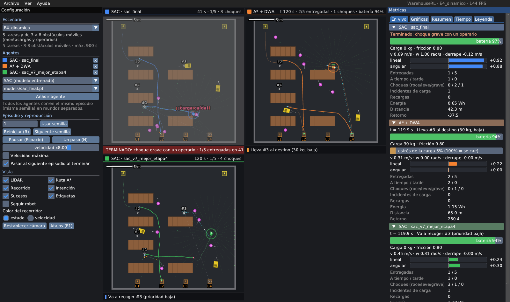

# WarehouseRL

Agente en C++20 para la gestión autónoma de tareas logísticas en un almacén 2D
**continuo** con **simulación física** (Box2D), entrenado con **Soft Actor-Critic**
(LibTorch). Implementa la propuesta técnica v2
(`Propuesta_WarehouseRL_Cpp_v2_Fisica_Continua.docx`) para la materia Sistemas
Inteligentes.

- El robot es un cuerpo rígido de tracción diferencial: masa, inercia, fuerza de
  motor limitada, adherencia con círculo de fricción (derrapa en giros bruscos o
  zonas resbaladizas) y resistencia a la rodadura.
- La carga cambia la masa e inercia del robot; acelerar o girar demasiado fuerte
  la desestabiliza. La batería se descarga según la potencia mecánica real.
- Varias tareas con prioridades y plazos, estaciones de recarga, montacargas y
  operarios que se mueven por los pasillos, LiDAR 2D y odometría simulados.
- Agente jerárquico: selector de tareas (heurístico) → ruta global A* → control
  continuo aprendido con SAC. Líneas base: política aleatoria y A* + DWA.

---

## Estructura

```
apps/                 programas: entrenar, evaluar, visor, benchmark, validación
  gui/                interfaz gráfica para ver y comparar agentes entrenados (wrl_gui)
configs/
  robot/default.json  parámetros físicos, energía, cargas, sensores y recompensas
  scenarios/          E0–E7 y un mapa fijo de ejemplo; train/ = etapas del currículo anterior (referencia)
  agent/sac.json      hiperparámetros de SAC, del entrenamiento, del generador y de la validación
include/warehouse/    cabeceras públicas por módulo
src/
  core/               matemáticas y generador aleatorio reproducible
  world/              mapa (explícito o procedural) y mapa de ocupación
  physics/            mundo Box2D, modelo del robot, obstáculos dinámicos
  sensors/            LiDAR y odometría
  planning/           A* con suavizado, ruta y controlador DWA
  sim/                gestor y selector de tareas, generador de escenarios y currículo adaptativo
  session/            sesión de visualización: agentes, episodios, reproducción (sin gráficos)
  env/                entorno de aprendizaje, entornos paralelos, políticas base
  agent/              SAC, memoria de repetición, política entrenada
  render/             dibujo con SFML
  io/                 configuración, métricas y trazas
tests/                pruebas GoogleTest (física, planificación, sensores, tareas, entorno, SAC)
```

## Requisitos

- Linux x86_64, CMake ≥ 3.24, GCC ≥ 13 (probado con GCC 16) y Ninja (opcional).
- Box2D 3.1, nlohmann/json, GoogleTest y SFML 3.1 se descargan solos (FetchContent).
- LibTorch 2.14.1 se descarga sola (~2.5 GB con CUDA) o se reutiliza una ya extraída.
- GPU NVIDIA opcional (driver con soporte CUDA 13). No hace falta `nvcc`: solo se
  usan las cabeceras de `/usr/local/cuda/include` para los CUDA Graphs.

## Compilación

```bash
cmake -S . -B build -G Ninja \
      -DLIBTORCH_DIR=/ruta/a/libtorch     # opcional: reutiliza una LibTorch ya descargada
cmake --build build
ctest --test-dir build --output-on-failure
```

Opciones útiles:

| Opción | Por defecto | Efecto |
|---|---|---|
| `WRL_BUILD_AGENT` | ON | agente SAC (necesita LibTorch) |
| `WRL_BUILD_VIEWER` | ON | visor SFML |
| `WRL_TORCH_VARIANT` | `cu130` | `cpu` para una LibTorch sin CUDA |
| `WRL_NATIVE` | ON | `-march=native` (AVX2/FMA en Ryzen) |
| `WRL_LTO` | ON | optimización en tiempo de enlace |

## Uso

```bash
# 1. Validar los escenarios con la línea base A* + DWA (riesgo "plazos imposibles")
./build/wrl_validate --episodes 8

# 2. Medir el rendimiento de la simulación en este equipo
./build/wrl_benchmark

# 3. Entrenar con escenarios generados y dificultad adaptativa (ver "Entrenamiento")
./build/wrl_train --out runs/sac_principal
#    Ctrl+C guarda el modelo. --resume modelo.pt para continuar (recupera los niveles).
#    --scenario archivo.json entrena en un escenario fijo, sin generador.
#    --blocking-wait libera el núcleo que espera a la GPU (≈2.6 % más lento).
./build/wrl_bench_sac        # mide cuánto tarda una actualización de SAC (fija la velocidad del entrenamiento)
./build/wrl_validate --generator 30   # comprueba el generador con la línea base A* + DWA

# 4. Evaluar (100 episodios repartidos en 5 semillas, sin exploración)
./build/wrl_evaluate --policy sac --model runs/sac_principal/sac_final.pt \
    --scenario configs/scenarios/e1_basico.json --scenario configs/scenarios/e5_combinado.json
./build/wrl_evaluate --policy dwa --scenario configs/scenarios/e4_dinamico.json

# 5. Interfaz gráfica: ver y comparar agentes entrenados (por defecto, SAC frente a A* + DWA en E1)
./build/wrl_gui
./build/wrl_gui --scenario configs/scenarios/e4_dinamico.json \
    --agent sac:models/sac_final.pt --agent sac:models/sac_v9.pt --agent dwa

# 6. Visor sencillo, reproducción de trazas y capturas
./build/wrl_viewer --scenario configs/scenarios/demo_mapa_fijo.json            # conducción manual
./build/wrl_viewer --scenario configs/scenarios/e5_combinado.json --policy dwa
./build/wrl_viewer --scenario configs/scenarios/e5_combinado.json --policy sac --model runs/sac_principal/sac_final.pt
./build/wrl_viewer --replay results/eval_sac/traces/E5_combinado_s0_e0.json   # reproducir una traza
```

### Interfaz gráfica (`wrl_gui`)



Ventana con tres zonas:

- **Configuración** (izquierda): escenario (E0–E7, mapa fijo y etapas del currículo),
  agentes (hasta 6: cualquier modelo `.pt` de `models/` o `runs/`, A* + DWA, aleatoria o
  manual), semilla, pausa, paso a paso, velocidad (x0.06 a x64 o máxima) y capas de la vista.
- **Vistas** (centro): una por agente, todas con el mismo episodio (misma semilla) en mundos
  separados. Cada vista tiene arriba el nombre y los contadores, y abajo una frase con lo que
  hace el robot ("Lleva #3 al destino (30 kg, baja) · vence en 40 s") más avisos del momento
  (DERRAPANDO, CARGA INESTABLE, BATERÍA BAJA, DETENIDO, EN ZONA RESTRINGIDA). La cámara es
  común: rueda para el zoom, arrastrar para moverla, doble clic para centrarla.
- **Sobre el mapa**, además del color de cada agente:
  - robot con ruedas, frente, batería encima, flecha de velocidad real y un anillo localizador;
  - **intención**: curva punteada con lo que haría en 1.5 s si mantuviera la acción actual de
    la política, que deja ver si "duda", gira en el sitio o va directo;
  - caja de carga que pasa de marrón a naranja y rojo según la aceleración que soporta;
  - recorrido grueso con carga, fino sin ella y amarillo mientras recarga, o coloreado por
    velocidad (tecla `V`); puntos rojos donde derrapó;
  - sucesos marcados donde ocurrieron (choques por gravedad, recogidas, entregas a tiempo o
    tarde, caídas de carga, recargas) con una onda y un texto los primeros segundos;
  - tareas con rombo por prioridad, número, anillo de plazo que se vacía y destino resaltado;
  - zonas resbaladizas y restringidas rayadas y con su valor, LiDAR rojo cuando algo está
    cerca, montacargas con horquillas y operarios con dirección de marcha, barra de escala.
- **Métricas** (derecha), en pestañas: *En vivo* (fase, batería, estrés de la carga,
  velocidades, acción de la política, entregas, choques, energía), *Gráficas* (batería,
  velocidad, retorno, entregas y estrés de la carga superpuestos), *Resumen* (medias de los
  episodios terminados), *Tiempo* (línea de tiempo por agente con las fases, cuándo lleva
  carga y los sucesos, más un registro de sucesos) y *Leyenda* con todos los símbolos.
  Con "velocidad máxima" y "pasar al siguiente episodio" sirve como evaluación rápida.

Atajos: `Espacio` pausa, `N` un paso, `R` reiniciar, `Enter` siguiente semilla, `+`/`-`
velocidad, `L`/`P`/`T`/`C` LiDAR, ruta, recorrido y seguir al robot, `V` color del recorrido,
`I`/`E`/`K` intención, sucesos y etiquetas, `F1` ayuda.

Arquitectura (la misma separación que en Proyecto_DQL):

```
wrl_core   simulación, entorno, políticas base y Session  ← sin gráficos ni Torch
   ↑                ↑
wrl_render (SFML)  wrl_agent (LibTorch: SAC, entrenamiento)
   ↑                ↑
wrl_gui = ImGui + wrl_render + Session; recibe las políticas por una fábrica
          (apps/policy_factory.hpp), así que la interfaz no conoce a LibTorch
          y el entrenamiento no conoce a la interfaz.
```

`Session` (`include/warehouse/session/session.hpp`) es el modelo de la interfaz: escenario,
agentes, reloj de reproducción e historial; tiene pruebas propias (`tests/test_session.cpp`).
La interfaz solo lee su estado y le envía órdenes. Dear ImGui 1.91.9 e ImGui-SFML 3.0 se
descargan solos.

Controles del visor sencillo (`wrl_viewer`): `Espacio` pausa, `N` un paso, `+`/`-` velocidad, `R`
reiniciar, `L` LiDAR, `P` ruta, `C` seguir al robot, rueda del ratón para el zoom,
`W/A/S/D` o flechas para conducir en modo manual.

`wrl_evaluate` escribe en `results/eval_<política>/` un CSV por episodio, un
`resumen.json` con las métricas de la sección 10.2 y el veredicto de los criterios
de aceptación de cada escenario, y trazas (`.json` reproducible + `.csv` de estados).

## Entrenamiento: escenarios generados en vez de etapas fijas

Las versiones anteriores entrenaban por etapas (E0 → cargas → energía → prioridades →
dinámico → combinado) y **olvidaban lo aprendido** al pasar a la siguiente: con ~3 000
transiciones/s, la memoria de repetición de 1 M solo guarda los últimos ~5 minutos, así
que a los pocos minutos de una etapa ya no queda ningún ejemplo de las anteriores.

Ahora (`src/sim/scenario_generator.cpp`):

1. **Generador por reglas.** Cada episodio de cada entorno usa un escenario nuevo con seis
   dimensiones de dificultad en [0, 1]: mapa (tamaño, pasillos), tareas (cantidad,
   prioridades, plazos), energía (batería, carga inicial), cargas (liviana → frágil),
   obstáculos móviles y terreno (zonas resbaladizas, zona restringida, variación física).
   Las reglas garantizan que el escenario se puede resolver:
   - pasillos de al menos 1.2 m libres además del inflado del robot;
   - batería suficiente para el viaje largo con la carga más pesada, y carga inicial
     suficiente para llegar a un cargador;
   - plazos con holgura de 3.5× (fácil) a 2.0× (difícil) el tiempo estimado; con plazos,
     las llegadas no son más rápidas que 0.9× el tiempo de atender una tarea (0.7× en el
     extremo difícil), así que se forma algo de cola como en E5, pero no crece sin límite;
   - como máximo un obstáculo móvil por cada ~80 m²;
   - tiempo máximo proporcional al trabajo pedido.

   El nivel 1 equivale aproximadamente a E5. E6 (pasillos de 2.4 m, 34 m de ancho) y E7
   (física fuera de rango) quedan fuera de lo que genera, para medir generalización.
2. **Currículo adaptativo, sin etapas.** Cada dimensión tiene un nivel dominado. En cada
   episodio todas se sortean entre 0 y su nivel (repaso), y en el 60 % de los episodios una
   sola se lleva un poco por encima (frontera). Si el éxito medio en la frontera supera 75 %
   el nivel sube 0.05; si baja de 35 %, baja. Lo fácil se sigue viendo siempre. En la
   mitad de los episodios de repaso (`jointProb`) las dimensiones se sortean correladas,
   para que también aparezcan episodios difíciles en todo a la vez, como E5.
3. **Mejor modelo por validación.** Cada 300 000 transiciones se evalúa la política
   determinista en E1–E5 con semillas fijas (distintas de las de `wrl_evaluate`) y se
   guarda `mejor_validacion.pt` si mejora. Antes se usaba la tasa del propio entrenamiento,
   que no detectaba el olvido.
4. **Críticos con LayerNorm** (`criticLayerNorm`), que frena la divergencia de Q cuando la
   distribución de escenarios es amplia.

### Correcciones de la recompensa y la observación

Reproduciendo episodios fallidos paso a paso aparecieron incentivos perversos; cada uno
explicaba una forma concreta de fallar:

| Comportamiento observado | Causa | Corrección |
|---|---|---|
| Retroceder contra una pared indefinidamente | El contacto sostenido no costaba nada | −1 por segundo en contacto (`contactPerSecond`) y bandera de contacto en la observación |
| Quedarse quieto junto al cargador | Al moverse se desconectaba y la detección de estancamiento quedaba desactivada | El robot queda frenado mientras carga y el estado se limpia al cambiar de objetivo |
| No reaccionar antes del corte por estancamiento | El temporizador no se veía | Progreso del temporizador en la observación y −1/s tras 5 s parado (`stuckPerSecond`) |
| Rendirse en E5 cuando la siguiente tarea ya estaba vencida | Entregar tarde daba −35 neto y quedarse parado cortaba el episodio, evitando las penalizaciones futuras | Entregar tarde suma siempre al menos +50, y un fracaso cuesta −20 por cada tarea no entregada (`abandonedTask`) |

La observación pasó de 74 a 77 valores (temporizador de estancamiento, cargando,
contacto); los modelos anteriores están en `models/obsoletos_obs74/` y ya no se pueden
cargar.

`wrl_validate --generator N` resuelve N escenarios por nivel con A* + DWA y muestra el
resultado por nivel, por dimensión aislada y quitando una dimensión cada vez. Con 30 por
nivel: 0 errores. En el nivel 1 la línea base completa 96 % y entrega a tiempo 47 % (en E5:
87 % y 50 %), así que el extremo difícil del generador es comparable a E5.

Al validar el generador apareció un fallo de la simulación: un montacargas bloqueado por
el robot se desviaba, pero a una ruta que volvía a pasar por el robot, y quedaban los dos
esperándose. Ahora el desvío elige un destino cuya ruta se aleja del robot.

En la interfaz (`wrl_gui`), "Escenario aleatorio (generador)" permite ver a los agentes en
escenarios generados con la dificultad que se elija (`--generated 0.8` desde la terminal).

## Escenarios

| Archivo | Contenido |
|---|---|
| `e0_navegacion` | 1 tarea liviana, mapa pequeño |
| `e1_basico` | 1 tarea, obstáculos estáticos, batería suficiente |
| `e2_energia` | 5 tareas con cargas de 5 a 30 kg, batería limitada, 2 estaciones |
| `e3_priorizacion` | 10 tareas con prioridades y plazos |
| `e4_dinamico` | 5 tareas y de 3 a 8 montacargas/operarios |
| `e5_combinado` | 15 tareas, energía, cargas, plazos, zonas resbaladizas, zona restringida y obstáculos |
| `e6_generalizacion` | otra geometría de almacén, no usada en el entrenamiento |
| `e7_robustez` | E5 con fricción, masa, motores y ruido fuera del rango de entrenamiento |
| `demo_mapa_fijo` | ejemplo de mapa definido a mano |

Los escenarios heredan de `configs/robot/default.json` con `"base"` y solo
sobreescriben lo que cambia; los criterios de aceptación de cada uno están en su
campo `"acceptance"`.

## Optimizaciones para el hardware (Ryzen 5 6600H + RTX 3050 Laptop 4 GB)

Medidas en este equipo:

| Medida | Valor |
|---|---|
| Simulación, 1 entorno, sin render (meta de la propuesta: 2 000) | ~24 000 pasos de control/s (~145 000 pasos físicos/s) |
| Línea base A* + DWA, 1 entorno | ~8 600 pasos/s |
| 96 entornos en 12 hilos | ~80 000 pasos/s |
| Actualizaciones de SAC (lote 512) | 380/s → **830/s** con CUDA Graph + Adam foreach |
| Entrenamiento completo (24 entornos, 0.25 act./transición, críticos con LayerNorm) | ~2 900 transiciones/s (15 M en ~90 min) |

Qué se hizo y por qué:

1. **Compilación**: `-O3 -march=native` (AVX2/FMA), Box2D con AVX2 y LTO.
2. **Física barata**: Box2D a 60 Hz con 4 subpasos y control a 10 Hz; el LiDAR
   (36 rayos) solo se lanza en los pasos de control; mundo sin hilos internos.
3. **Paralelismo por entornos** (`VecEnv`): hilos fijos sincronizados con
   `std::barrier`, buffers contiguos y reinicio automático. Box2D guarda los mundos
   en un registro global sin sincronizar (máx. 128): la creación y destrucción se
   protegen con un mutex.
4. **GPU limitada por lanzamientos de kernels**: con redes de 256×256, cada
   actualización tardaba ~2.1 ms de CPU solo en lanzar operaciones. Se resolvió con:
   - críticos gemelos fusionados en una sola red (un `baddbmm` por capa),
   - Adam propio con operaciones `_foreach` (pocos kernels para todos los tensores),
   - **CUDA Graph**: muestreo de la memoria + actualización completa (crítico,
     actor, α y Polyak) se capturan una vez y se reproducen con un lanzamiento,
   - TF32 para las multiplicaciones de matrices (Ampere).
5. **Memoria de repetición en la GPU** (1 M transiciones ≈ 600 MB de los 4 GB),
   con muestreo en el propio dispositivo; una sola copia CPU→GPU por paso, desde
   memoria fijada y asíncrona.
6. **Solapamiento CPU/GPU**: las actualizaciones se encolan de forma asíncrona y
   la CPU avanza los 24 entornos mientras tanto; la única sincronización por paso
   es traer las acciones del actor.
7. **Hilos**: 6 hilos de simulación (uno por núcleo físico); Torch usa 1 hilo
   cuando entrena en GPU para no competir con la simulación.
8. **Calentamiento con demostraciones**: las primeras 20 000 transiciones las
   genera la línea base DWA con ruido, lo que acelera el aprendizaje inicial.
9. **Corte por estancamiento**: un episodio sin acercarse al objetivo durante 30 s
   se trunca, para no gastar muestras en estados atascados.

Sin GPU todo funciona en CPU (`--device cpu`), más despacio.

**Dónde se va el tiempo.** `wrl_train` muestra el desglose de cada iteración: ~94 % es
esperar a la GPU, ~4 % simulación y ~2 % el resto. El núcleo al 100 % que se ve en el
monitor es CUDA esperando activamente a la GPU, no cálculo. Por eso acelerar la
simulación (más AVX, pasarla a la GPU) no aceleraría el entrenamiento; lo que manda es
el tiempo de cada actualización de SAC (`wrl_bench_sac`: ~1.3 ms con lote 512).
Mediciones alternando ejecuciones:

| Opción | Transiciones/s | Decisión |
|---|---|---|
| FP32 | ~2 520 | — |
| TF32 (`"tf32"` en `sac.json`) | ~2 890 (+15 %) | activado por defecto |
| TF32 + espera bloqueante (`--blocking-wait`) | ~2 810 (−2.6 %), CPU de 104 % a 25 % de un núcleo | opcional |

## Resultados

Ver `docs/RESULTADOS.md` (tablas generadas con `tools/reporte.py` a partir de
`wrl_evaluate`). El modelo entregado (`models/sac_final.pt`, v10, elegido por validación
en E1–E5) frente a la línea base A* + DWA, 100 episodios por escenario:

| Escenario | Completadas DWA | Completadas SAC | A tiempo DWA | A tiempo SAC |
|---|---|---|---|---|
| E1 básico | 98.0 % | **100 %** | 98.0 % | **100 %** |
| E2 energía | 95.2 % | **100 %** | 95.2 % | **100 %** |
| E3 priorización | 94.3 % | **98.4 %** | 83.7 % | **98.1 %** |
| E4 dinámico | **95.2 %** | 94.8 % | **95.2 %** | 94.8 % |
| E5 combinado | **87.2 %** | 78.3 % | 50.3 % | **52.0 %** |
| E6 generalización* | **95.9 %** | 91.1 % | 61.6 % | **66.3 %** |
| E7 robustez física* | **90.8 %** | 82.9 % | 51.7 % | **57.7 %** |

\* Fuera de la distribución de entrenamiento y de validación.

SAC entrega antes y a tiempo más a menudo en todos los escenarios con plazos, pero
**todavía choca más**: colisiones graves con operarios en E4–E7 (DWA casi ninguna) y
~9–14 % de incidentes de carga frente a < 2 %. En E5 un tercio de los episodios fallidos
siguen terminando por estancamiento. `models/sac_v9.pt` (antes de corregir la
recompensa) completaba 32 % en E5, 58 % en E6 y 38 % en E7.

## Diferencias con la propuesta

- El **selector de tareas aprendido** (DQN sobre candidatas) no se implementó; el
  nivel alto es la heurística (modo híbrido de la propuesta).
- La **extensión multiagente** (sección 13) no está implementada. El código deja
  preparados los puntos de extensión: las formas de Box2D llevan el índice del
  robot, los obstáculos se perciben igual que lo haría otro robot y la observación
  es local (sirve para compartir parámetros entre robots).
- Las acciones de recoger, entregar y recargar son automáticas al acoplarse
  (posición dentro de 0.4 m y velocidad < 0.1 m/s durante 0.5 s), como describe la
  sección 8.2.
- El controlador de motores tiene una **rampa de aceleración** (1.2 m/s², 4 rad/s²), como
  un AGV real; la aceleración efectiva sigue dependiendo de masa y adherencia.
- Una vez iniciada, la **recarga** tolera movimientos de hasta 2 radios de acoplamiento.
- Un episodio sin acercarse al objetivo durante 30 s termina como fracaso (−50, más −20
  por cada tarea no entregada).
- Para que los obstáculos no bloqueen pasillos indefinidamente, frenan si el robot
  está justo delante y, tras esperar ~3 s, cambian de ruta. No ceden el paso en
  cruces laterales.
