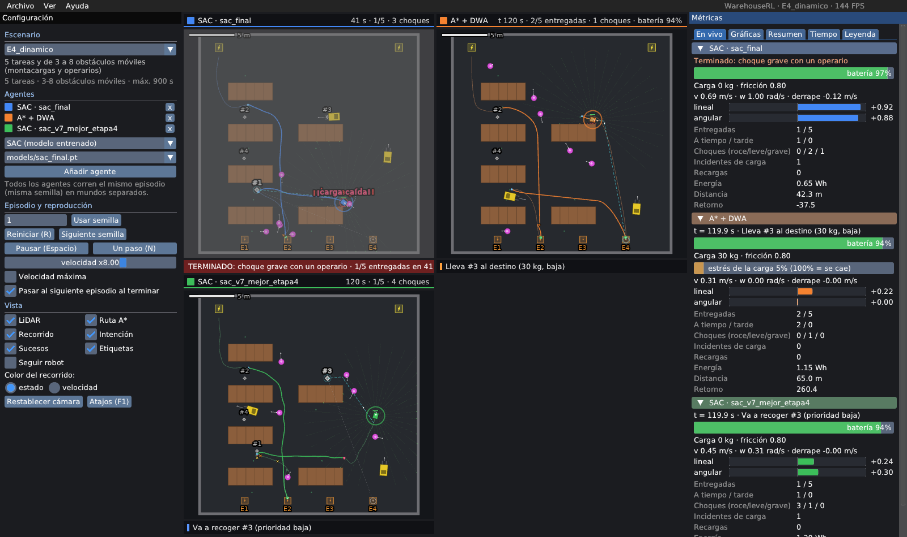

# WarehouseRL — Informe del proyecto

**Agente en C++20 para la gestión autónoma de tareas logísticas en un almacén 2D continuo con simulación física**

Asignatura: Sistemas Inteligentes — Ingeniería de Sistemas · Noviembre de 2026
Repositorio: <https://github.com/bonex-ishmov/warehouseRL-Cpp>

---

## Contenido

1. [Resumen](#1-resumen)
2. [Objetivo y alcance](#2-objetivo-y-alcance)
3. [Arquitectura del software](#3-arquitectura-del-software)
4. [Simulación física](#4-simulación-física)
5. [Entorno de aprendizaje](#5-entorno-de-aprendizaje)
6. [Agente](#6-agente)
7. [Entrenamiento](#7-entrenamiento)
8. [El entrenamiento por dentro](#8-el-entrenamiento-por-dentro)
9. [Capa de seguridad](#9-capa-de-seguridad)
10. [Rendimiento y optimización para el hardware](#10-rendimiento-y-optimización-para-el-hardware)
11. [Historia del desarrollo y decisiones](#11-historia-del-desarrollo-y-decisiones)
12. [Resultados](#12-resultados)
13. [Criterios de aceptación de la propuesta](#13-criterios-de-aceptación-de-la-propuesta)
14. [Herramientas de diagnóstico y visualización](#14-herramientas-de-diagnóstico-y-visualización)
15. [Pruebas y reproducibilidad](#15-pruebas-y-reproducibilidad)
16. [Diferencias con la propuesta](#16-diferencias-con-la-propuesta)
17. [Limitaciones y trabajo futuro](#17-limitaciones-y-trabajo-futuro)
18. [Cómo reproducir los resultados](#18-cómo-reproducir-los-resultados)
- [Anexo A. Métricas completas por escenario](#anexo-a-métricas-completas-por-escenario)
- [Anexo B. Parámetros principales](#anexo-b-parámetros-principales)

---

## 1. Resumen

WarehouseRL es un simulador de almacén 2D en espacio continuo, escrito en C++20 sobre el motor de física
Box2D, y un agente que lo opera. El robot es un cuerpo rígido de tracción diferencial con masa, inercia,
fuerza de motor limitada y adherencia. La carga cambia su dinámica y puede caerse en giros o frenadas
bruscas. La batería se descarga según la potencia mecánica. El robot atiende varias tareas con prioridades
y plazos, entre montacargas y operarios que se mueven por los pasillos.

El agente es jerárquico:
- un **selector de tareas heurístico** decide qué hacer;
- un **planificador A\*** decide por dónde ir;
- un **controlador continuo aprendido con Soft Actor-Critic (SAC)**, en LibTorch y con GPU, decide cómo
  moverse.

Una **capa de seguridad** fija, entre la política y los motores, impide acercarse a cualquier cosa más rápido
de lo que permite frenar y limita la aceleración lateral cuando lleva carga.

**Resultado principal.** El modelo entregado es el v14 con la capa de seguridad, evaluado en 100 episodios
por escenario repartidos en 5 semillas. Se compara con la línea base clásica A\* + DWA con la misma capa:

| | A\* + DWA + capa | **SAC v14 + capa** |
|---|---|---|
| Tareas completadas, E1–E4 | 96.2–99.0 % | **98.6–100 %** |
| Tareas completadas, E5 (escenario combinado) | **93.4 %** | 91.7 % |
| Tareas completadas, E6 / E7 (fuera de entrenamiento) | 95.6 / 93.4 % | **96.6 / 94.3 %** |
| Entregas a tiempo, E3 / E5 / E6 / E7 | 86.6 / 53.3 / 59.7 / 51.2 % | **98.0 / 53.6 / 66.3 / 56.4 %** |
| Choques graves con operarios, E4–E7 (en 400 episodios) | 3 | 3 |
| Caídas de carga por entrega, E4–E7 | **1.3–1.7 %** | 2.8–4.8 % |

SAC completa tanto o más que la línea base y es más puntual. Choca con operarios igual de poco, pero sigue
rozando más, dejando caer más cargas y gastando más energía en los escenarios con obstáculos móviles.

Sin la capa de seguridad, el mejor modelo entrenado solo con recompensa (v12) completaba 89.3 % en E5, con
5 choques graves con operarios en E5 y 21 entre E4 y E7. La línea base sin capa completaba 87.3 % en E5.

---

## 2. Objetivo y alcance

### 2.1 Objetivo general (de la propuesta v2)

Implementar y evaluar en C++ un agente que controle, mediante comandos continuos, un robot móvil sometido a
dinámica física en un almacén 2D, atendiendo múltiples tareas logísticas con restricciones de batería,
cargas heterogéneas, ventanas de tiempo y obstáculos dinámicos.

La propuesta original (`Propuesta_WarehouseRL_Cpp_Alcance_Intermedio.docx`) usaba una cuadrícula. Antes de
empezar se reescribió como versión 2 (`Propuesta_WarehouseRL_Cpp_v2_Fisica_Continua.docx`), con tres
cambios:
- movimiento libre en el plano en vez de cuadrícula;
- física real (Box2D) que afecte al modelo;
- la extensión multiagente solo como propuesta no verificada.

### 2.2 Estado de los objetivos específicos

| Objetivo específico | Estado |
|---|---|
| Simulador determinista y configurable sobre Box2D | Cumplido: paso fijo, semillas explícitas, todo en JSON |
| Robot de tracción diferencial con límites de fuerza, aceleración, velocidad y adherencia | Cumplido |
| Efecto de la carga sobre masa, inercia, frenado, consumo y estabilidad | Cumplido |
| Recogida, entrega y recarga por acoplamiento con tolerancias | Cumplido (0.4 m, < 0.1 m/s durante 0.5 s) |
| Varias tareas con prioridades y plazos | Cumplido (baja, media, alta, crítica; llegadas durante el episodio) |
| Obstáculos dinámicos con rutas y perfiles de velocidad | Cumplido (montacargas y operarios) |
| LiDAR 2D y odometría con ruido | Cumplido |
| Agente SAC jerárquico y líneas base aleatoria y A\* + DWA | Cumplido; el selector de tareas es heurístico, no aprendido |
| Registro de episodios, métricas, semillas y configuración en CSV/JSON | Cumplido, con trazas reproducibles |
| Pruebas unitarias, de física, de integración y escenarios de aceptación | Cumplido: 64 pruebas GoogleTest |
| Extensión multiagente | No implementada; el código deja puntos de extensión |

---

## 3. Arquitectura del software

### 3.1 Bibliotecas y programas

El código está separado en bibliotecas con dependencias en un solo sentido, con la misma organización que
el proyecto previo del autor (Proyecto_DQL):

```
wrl_core     simulación, entorno, planificación, sensores, tareas, capa de seguridad,
             políticas base (aleatoria, A* + DWA, manual) y Session      ← sin gráficos ni Torch
   ↑                    ↑
wrl_render (SFML)    wrl_agent (LibTorch: SAC, memoria de repetición, política entrenada)
   ↑                    ↑
wrl_gui  = Dear ImGui + wrl_render + Session; recibe las políticas por una fábrica
           (apps/policy_factory.hpp): la interfaz no conoce a LibTorch y el entrenamiento
           no conoce a la interfaz.
```

| Programa | Función |
|---|---|
| `wrl_train` | Entrenamiento SAC con entornos paralelos, generador de escenarios, currículo adaptativo y validación |
| `wrl_evaluate` | Evaluación determinista: CSV por episodio, `resumen.json` con métricas y criterios, trazas reproducibles |
| `wrl_gui` | Interfaz gráfica para ver y comparar hasta 6 agentes en el mismo episodio |
| `wrl_viewer` | Visor sencillo, conducción manual y reproducción de trazas |
| `wrl_collisions` | Diagnóstico de cada choque y de cada caída de carga |
| `wrl_validate` | Comprueba con A\* + DWA que los escenarios y el generador son resolubles |
| `wrl_benchmark`, `wrl_bench_sac` | Rendimiento de la simulación y de una actualización de SAC |
| `tools/reporte.py`, `tools/comparar.py` | Tablas de resultados (`docs/RESULTADOS.md`) y comparación de evaluaciones |

### 3.2 Módulos

| Directorio | Contenido |
|---|---|
| `src/core` | Vectores, poses, rectángulos, generador aleatorio reproducible (`mixSeed`) |
| `src/world` | Mapa explícito o procedural, mapa de ocupación inflado para A\* |
| `src/physics` | Envoltura RAII del mundo Box2D, modelo del robot, obstáculos dinámicos |
| `src/sensors` | LiDAR por lanzamiento de rayos, odometría, percepción de obstáculos (GJK) |
| `src/planning` | A\* con suavizado de ruta, seguimiento de puntos de paso, DWA |
| `src/sim` | Gestor y selector de tareas, generador de escenarios, currículo adaptativo |
| `src/env` | Entorno de aprendizaje (`WarehouseEnv`), entornos paralelos (`VecEnv`), capa de seguridad, políticas base |
| `src/agent` | SAC, memoria de repetición en GPU, política entrenada |
| `src/session` | Modelo de la interfaz: escenario, agentes, reloj de reproducción, historial |
| `src/render` | Dibujo con SFML |
| `src/io` | Configuración JSON con herencia (`"base"`), métricas CSV y trazas |

Tamaño: unas 6 600 líneas en la biblioteca (`src/` + `include/`, 53 archivos), 3 200 en los programas y
1 100 en las pruebas.

### 3.3 Dependencias

Todas se descargan con CMake FetchContent y versiones fijadas: Box2D 3.1, nlohmann/json, GoogleTest,
SFML 3.1, Dear ImGui 1.91.9 e ImGui-SFML 3.0. La única excepción es LibTorch 2.14.1 (CUDA 13), que se puede
reutilizar si ya está descargada.

GCC 16 no es compatible con `nvcc`, así que el proyecto enlaza las bibliotecas precompiladas de LibTorch
directamente. Para los CUDA Graphs basta con las cabeceras de CUDA.

Todos los parámetros (robot, energía, cargas, sensores, recompensas, capa de seguridad, escenarios, SAC)
están en JSON. Los escenarios heredan de `configs/robot/default.json` con `"base"` y solo sobrescriben lo
que cambian.

---

## 4. Simulación física

### 4.1 Mundo

- Vista cenital, unidades SI, sin gravedad vertical.
- Muros y estanterías son cuerpos estáticos, el robot es dinámico y los obstáculos móviles son cinemáticos.
- Paso físico fijo de 1/60 s con 4 subpasos del solucionador; el agente decide a 10 Hz y cada acción se
  mantiene 6 pasos físicos.
- Detección continua de colisiones para el robot.
- Almacenes procedurales de 20 × 20 a 40 × 40 m con pasillos, estanterías, muelles de recogida y entrega,
  estaciones de recarga, zonas resbaladizas (μ 0.3–0.5) y zonas restringidas.

### 4.2 Robot

| Parámetro | Valor |
|---|---|
| Forma y masa | Rectángulo de 0.6 × 0.5 m, 50 kg en vacío |
| Velocidad máxima | 1.5 m/s hacia adelante, 0.3 m/s en reversa, 2 rad/s de giro |
| Motores | 60 N por rueda, lazo de velocidad, rampa de consigna de 1.2 m/s² y 4 rad/s² |
| Adherencia | μ = 0.8 nominal; el impulso lateral por rueda se limita a μ·m·g y por encima derrapa |
| Resistencia a la rodadura | 0.02 |

El agente no aplica fuerzas: pide velocidad lineal y angular, y un controlador las convierte en fuerzas por
rueda saturadas. Así la aceleración real depende de la masa total y del suelo, y el robot no puede frenar
ni girar instantáneamente.

### 4.3 Carga

Cuatro tipos de carga:

| Tipo | Masa | Límite lateral | Límite longitudinal |
|---|---|---|---|
| Liviana | 5 kg | 3.5 m/s² | 3.5 m/s² |
| Media | 15 kg | 3.0 m/s² | 3.0 m/s² |
| Pesada | 30 kg | 2.5 m/s² | 2.5 m/s² |
| Frágil | 10 kg | 1.6 m/s² | 1.8 m/s² |

La carga se suma a la masa e inercia del robot. Si la aceleración filtrada que siente (una IMU con 0.1 s de
suavizado) supera su límite, se desestabiliza: la tarea registra un incidente y hay que recogerla de nuevo.

### 4.4 Energía

Batería de 20 Wh. El consumo es P_base (20 W) + Σ|F·v| / η (η = 0.8), integrado en cada paso físico, así que
acelerar con carga, frenar y arrancar repetidamente o derrapar cuesta más.

La recarga es de 250 W y solo ocurre acoplado y detenido en una estación. Mientras carga, el robot queda
frenado hasta terminar. El selector reserva un 15 % de batería para llegar a una estación.

### 4.5 Colisiones

La gravedad se mide por la velocidad relativa de impacto a lo largo de la normal de contacto:

| Gravedad | Velocidad | Efecto |
|---|---|---|
| Roce | < 0.2 m/s | castigo leve, no cuenta para el límite |
| Leve | 0.2–0.8 m/s | castigo, cuenta para el límite (10 por episodio) |
| Grave | > 0.8 m/s | castigo fuerte; con un operario termina el episodio |

### 4.6 Obstáculos dinámicos

Montacargas (cajas de 1.2 × 0.8 m) y operarios (círculos de 0.3 m de radio) recorren rutas con pausas o se
mueven de forma estocástica suave.

Los obstáculos "cautos" se detienen si el robot está justo delante, y tras esperar ~3 s cambian de ruta. El
desvío elige un destino cuya ruta se aleja del robot; esto corrigió un bloqueo mutuo que apareció al validar
el generador. **Ninguno cede el paso en cruces laterales**, como pide la propuesta, y eso explica la mayoría
de los choques que quedan con la capa de seguridad.

### 4.7 Sensores

- **LiDAR:** 36 rayos sobre 360°, alcance de 8 m, ruido gaussiano y pérdidas configurables. Detecta la
  geometría estática y los obstáculos.
- **Odometría:** velocidad con ruido relativo configurable.
- **Percepción de obstáculos:** los 3 más cercanos en línea de vista. Para cada uno se calcula con GJK
  (Box2D) la distancia entre la carrocería del robot y la superficie del obstáculo, la dirección y la
  velocidad de acercamiento.

### 4.8 Aleatorización de dominio

El generador perturba en cada episodio la fricción (hasta ±30 %), la masa del robot (hasta ±15 %), la fuerza
de los motores (hasta ±10 %), el ruido del LiDAR (hasta 0.05 m) y la velocidad de los obstáculos (±20 %),
según su dimensión "terreno". E7 usa rangos mayores, fuera de lo visto en entrenamiento: fricción ±45 %, masa ±25 %, motores
±20 %, ruido del LiDAR hasta 0.08 m y velocidad de los obstáculos ±30 %.

---

## 5. Entorno de aprendizaje

### 5.1 Observación (86 valores, centrada en el robot y normalizada)

| Bloque | Valores | Contenido |
|---|---|---|
| LiDAR | 36 | distancias / 8 m |
| Movimiento | 4 | velocidad lineal y angular medidas, acción anterior (2) |
| Guía | 6 | distancia (tanh), seno y coseno del rumbo al punto de paso de A\* y al objetivo |
| Acoplamiento | 2 | dentro de la zona de acoplamiento, progreso del acoplamiento |
| Estado | 6 | batería, masa de la carga, fase (ir a recoger / a entregar / a recargar / esperar, *one-hot*) |
| Tarea | 2 | holgura hasta el plazo, prioridad |
| Obstáculos | 3 × 8 | posición y velocidad relativas, presente, es operario, distancia entre superficies (tanh), velocidad de acercamiento |
| Estado físico | 6 | velocidad lateral (derrape), estrés lateral y longitudinal de la carga, temporizador de estancamiento, cargando, en contacto |

La observación no depende del tamaño del mapa, así que la misma red sirve en almacenes no vistos.

Ha cambiado dos veces: 74 → 77 valores en el v9 y 77 → 86 en el v11. Los modelos de 77 observaciones
(v9, v10) se siguen pudiendo cargar: la política detecta el tamaño del modelo y le da la observación en su
formato antiguo (`WarehouseEnv::toLegacyObservation`).

### 5.2 Acción

Dos valores continuos en [−1, 1]:
- velocidad lineal deseada, escalada a [−0.3, 1.5] m/s;
- velocidad angular deseada, escalada a [−2, 2] rad/s.

Recoger, entregar y recargar son automáticos al cumplir las condiciones de acoplamiento. La elección de
tarea la hace el nivel alto.

### 5.3 Recompensa

Valores finales de `configs/robot/default.json`. La columna de la derecha indica los cambios del perfil de
entrenamiento con capa de seguridad (`configs/robot/capa.json`), con el que se afinó el v14.

| Término | Valor | Con capa (v14) |
|---|---|---|
| Entrega a tiempo / crítica a tiempo | +100 / +150 | |
| Recogida, recarga completada | +15, +15 | |
| Progreso hacia el punto de paso (diferencia de potencial) | +1 por m | |
| Tiempo, energía, brusquedad | −0.1/s, −0.02/kJ, −0.05·\|Δa\| | |
| Roce / leve / grave | −5 / −25 / −100 | |
| Roces y leves con operarios | ×2 | |
| Choque con obstáculo móvil estando el robot parado o alejándose | ×0.25 | |
| Velocidad insegura (por m/s de exceso y segundo), operarios / montacargas | −3 / −1.5 | 0 / 0 |
| Recorte de la capa de seguridad (por segundo y distancia normalizada entre la orden pedida y la ejecutada) | 0 | −2 |
| Carga desestabilizada | −40 | |
| Entrega tardía | −20 − 0.2 por s de retraso, tope −50 | tope −90 |
| Tarea crítica vencida | −75 | |
| Batería agotada, recarga innecesaria, zona restringida | −50, −2, −5 | |
| En contacto con algo | −1 por segundo | |
| Más de 5 s sin avanzar | −1 por segundo | |
| Corte por estancamiento (30 s sin acercarse al objetivo) | −50 | |
| Tarea sin entregar al terminar en fracaso | −20 cada una | |

El progreso se define como diferencia de potencial, lo que no cambia la política óptima e impide sumar
recompensa dando vueltas. La "velocidad insegura" sigue el criterio de *speed and separation monitoring*
de los AGV. Si el robot va hacia un obstáculo más rápido que

v_segura = √(2·a·(hueco − margen − lo que el obstáculo avanza hacia él en 1 s)),

con a = 1 m/s² y márgenes de 0.4 m con operarios y 0.2 m con montacargas, el exceso se castiga.

### 5.4 Fin del episodio

Un episodio termina en uno de estos casos:
- cola completada;
- batería agotada lejos de una estación;
- tiempo máximo;
- choque grave con un operario;
- límite de 10 choques;
- 30 s sin acercarse al objetivo (estancamiento).

---

## 6. Agente

### 6.1 Jerarquía

| Nivel | Responsabilidad | Implementación |
|---|---|---|
| Alto | Qué hacer: siguiente tarea, recargar o esperar | `TaskSelector`: puntúa las tareas por prioridad, urgencia del plazo y distancia, y reserva energía para llegar a una estación tras la entrega. Las tareas críticas desplazan a las aún no recogidas. |
| Medio | Por dónde ir | A\* sobre el mapa de ocupación inflado (0.55 m) con costo por cercanía a obstáculos, ruta suavizada, replanificación cada 2 s o al salirse 1.5 m |
| Bajo | Cómo moverse | SAC: velocidad lineal y angular a 10 Hz. Sigue el punto de paso como guía, pero decide libremente la trayectoria, la velocidad y las maniobras |
| Seguridad | Qué no se permite | `SafetyShield`: recorta la orden antes de los motores (sección 9) |

El mapa de ocupación existe solo para planificar: el robot nunca se mueve sobre la cuadrícula.

### 6.2 SAC

- Actor gaussiano con tanh y dos críticos gemelos, perceptrones de 2 × 256.
- Los críticos llevan LayerNorm y están fusionados en una sola red (una multiplicación por lotes por capa).
- Temperatura α automática con entropía objetivo −2 y α mínima 0.003.
- γ = 0.99, τ = 0.005, tasas de aprendizaje 3·10⁻⁴, lote de 512, escala de recompensa 0.1, recorte del
  gradiente en 5.
- Memoria de repetición de 1 M de transiciones en la GPU.
- 0.25 actualizaciones por transición; 24 entornos en 6 hilos.

Se eligió SAC porque las acciones son continuas, aprovecha cada muestra varias veces (memoria de
repetición) y su regularización por entropía da una exploración estable. PPO quedaba como alternativa y no
fue necesario.

### 6.3 Líneas base

- **Aleatoria:** acciones uniformes; completa 0 %.
- **A\* + DWA:** el mismo selector y planificador, más un *Dynamic Window Approach* que busca la mejor
  velocidad admisible según rumbo al punto de paso, holgura con obstáculos (incluidos los móviles,
  proyectados) y velocidad.

---

## 7. Entrenamiento

Esta sección resume cómo se organiza el entrenamiento; la sección 8 explica su funcionamiento técnico
(bucle, SAC, memoria de repetición, CUDA Graph, generador y validación) con detalle.

### 7.1 Generador de escenarios y currículo adaptativo

Cada episodio de cada entorno usa un almacén nuevo, generado por reglas con seis dimensiones de dificultad
en [0, 1]:

| Dimensión | Qué controla |
|---|---|
| Mapa | tamaño del almacén y pasillos |
| Tareas | cantidad, prioridades y plazos |
| Energía | batería y carga inicial |
| Cargas | de liviana a frágil |
| Obstáculos | número y velocidad de los obstáculos móviles |
| Terreno | zonas resbaladizas, zona restringida y variación física |

Las reglas garantizan que el escenario se puede resolver:
- pasillos con al menos 1.2 m libres además del inflado;
- batería suficiente para el viaje más largo con la carga más pesada;
- plazos con holgura de 3.5× (fácil) a 2.0× (difícil) el tiempo estimado;
- llegadas no más rápidas que 0.7–0.9× el tiempo de atender una tarea;
- un obstáculo cada ~80 m² como máximo;
- tiempo máximo proporcional al trabajo.

`wrl_validate --generator 30` resolvió 540 escenarios con A\* + DWA sin errores. En el nivel 1 la línea base
completa 96 % y entrega a tiempo 47 %, comparable a E5 (87 % y 50 %).

El **currículo** no tiene etapas:
- cada dimensión tiene un nivel dominado, y en cada episodio todas se sortean entre 0 y ese nivel (repaso);
- en el 60 % de los episodios una sola dimensión se lleva un poco por encima (frontera);
- si el éxito medio en la frontera supera 75 %, el nivel sube 0.05; si baja de 35 %, baja;
- en la mitad de los episodios de repaso las dimensiones se sortean correlacionadas, para que también haya
  episodios difíciles en todo a la vez, como E5.

E6 (otra geometría: pasillos de 2.4 m y 34 m de ancho) y E7 (física fuera de rango) quedan fuera de lo que
genera, para medir generalización.

### 7.2 Selección del modelo por validación

Cada 400 000 transiciones, la política determinista se evalúa en E1–E5 con 10 episodios por escenario y
semillas fijas, distintas de las de evaluación. Se guarda `mejor_validacion.pt` si mejora el puntaje:

puntaje = (1 − w)·completadas + w·a tiempo − 0.5·graves con operario/ep − 0.5·caídas de carga/entrega − 0.02·choques/ep

con w = 0 en el v12 y w = 0.5 en el v14.

En el v12 y en el v14 el modelo del final del entrenamiento fue claramente peor que el elegido por
validación: en E5, 72 % frente a 89 % en el v12 y 79 % frente a 92 % en el v14. En el v10, el del final
rendía más en E5 (88 %), pero menos en E6 y E7; se mantuvo el de validación porque era el criterio fijado
de antemano.

### 7.3 Calentamiento y afinado

- **Desde cero:** las primeras 20 000 transiciones las genera A\* + DWA con ruido (demostraciones).
- **Al afinar un modelo** (`--resume` con `warmupPolicy: "actor"`):
  - el calentamiento usa el propio modelo cargado;
  - el modelo de partida se valida antes de empezar y compite por `mejor_validacion.pt`, así que el
    afinado no puede empeorar lo que mide la validación.

### 7.4 Costo

| Entrenamiento | Transiciones | Tiempo |
|---|---|---|
| Completo desde cero (v8–v13) | 15 M | ~90–110 min |
| Afinado con capa (v14) | 4 M | 28 min |

---

## 8. El entrenamiento por dentro

Esta sección describe qué hace `wrl_train` (`apps/train.cpp`) paso a paso y cómo está implementado SAC
(`src/agent/sac.cpp`), con los números de una corrida típica.

### 8.1 Formulación

El problema es un proceso de decisión de Markov parcialmente observable:
- **Observación:** el vector de 86 valores de la sección 5.1.
- **Acción:** a ∈ [−1, 1]², velocidad lineal y angular deseadas.
- **Frecuencia:** el agente decide a 10 Hz y entre dos decisiones pasan 6 pasos físicos.

Cada decisión produce una transición (s, a, r, s′, d):

| Componente | Qué es |
|---|---|
| s′ | Observación siguiente. Si el episodio terminó, es la **observación final**, antes del reinicio automático del entorno. |
| r | Recompensa acumulada en los 6 pasos físicos (sección 5.3). |
| d = 1 | Solo si el episodio **terminó de verdad**: cola completada, batería agotada, choque grave con un operario, límite de choques o estancamiento. |
| d = 0 al cortar por tiempo máximo | Es un **truncamiento**: el estado siguiente no es terminal y el objetivo del crítico sigue usando su valor. Tratarlo como terminal enseñaría al agente que el tiempo máximo es parte del problema. |

**Horizonte efectivo.** Con γ = 0.99 por decisión, el horizonte es 1/(1 − γ) = 100 decisiones, es decir,
unos 10 s de simulación. Los objetivos más lejanos, como una entrega a varios minutos o un plazo, le llegan
al agente de dos formas:
- el **término de progreso**, Φ(s) = −1 · (metros de ruta A\* que faltan), que suma Φ(s′) − Φ(s) en cada
  paso;
- las variables que anticipan el futuro en la observación (holgura del plazo, batería, temporizador de
  estancamiento).

El término de progreso no se suma en el paso en que la ruta se replanifica, porque la nueva ruta cambia el
potencial sin que el robot se haya movido. Se aplica sin el factor γ (γ·Φ(s′) − Φ(s) en la forma de Ng et
al.), una aproximación habitual con γ cercano a 1.

**Escala de la recompensa.** Las recompensas se multiplican por 0.1 antes de entrar al crítico: una entrega
a tiempo (+100) vale 10 en las unidades de Q. Así los valores de Q quedan en un rango en el que la
temperatura α y las tasas de aprendizaje por defecto de SAC funcionan.

### 8.2 Una iteración del bucle

Hay 24 entornos en paralelo y en cada iteración todos avanzan un paso. Una iteración produce 24
transiciones y encola 24 × 0.25 = 6 actualizaciones de SAC:

```
CPU (hilo principal + 5 hilos de simulación)          GPU (un stream)
─────────────────────────────────────────────          ─────────────────────────────────────
1. copiar las 24 observaciones a memoria fijada  ───►  copia asíncrona CPU→GPU
2. actor estocástico en lote (24 × 86 → 24 × 2)  ───►  inferencia
   copiar las acciones de vuelta  ◄── espera ───────  (aquí la CPU espera a todo lo encolado)
3. encolar 6 actualizaciones (6 × CUDA Graph)    ───►  6 × [muestrear 512, crítico, actor, α, Polyak]
4. avanzar los 24 entornos en 6 hilos                   ... la GPU trabaja mientras tanto ...
   (capa de seguridad, 6 pasos físicos, tareas,
    recompensa, LiDAR, observación; reinicio
    automático de los que terminaron)
5. empaquetar r, d y s′ en memoria fijada        ───►  copia asíncrona y escritura circular en la memoria
6. currículo: informar los episodios terminados
7. cada 10 000 transiciones, registro; cada 200 000, punto de control; cada 400 000, validación
```

La única sincronización por iteración está en el paso 2: copiar las acciones a la CPU obliga a esperar a que
la GPU termine las 6 actualizaciones de la iteración anterior. Por eso el desglose que imprime `wrl_train`
muestra ~90 % del tiempo en "acciones + espera GPU" y ~8 % en simulación. La GPU es el límite, y con ella la
duración de cada actualización (~1.3 ms con lote de 512).

Detalles de implementación:
- **Memoria fijada (*pinned*):** las observaciones, acciones, recompensas y banderas pasan por buffers de
  este tipo, lo que permite copias asíncronas.
- **Buffers alternos:** los de s′, r y d se alternan en dos juegos (paridad), para que escribir los de un
  paso nunca pise una copia anterior que la GPU aún no haya leído.
- **Hilos:** Torch usa un solo hilo de CPU cuando entrena en GPU, para no competir con los 6 de
  simulación, uno por núcleo físico.

### 8.3 Entornos en paralelo (`VecEnv`)

`VecEnv` (`src/env/vec_env.cpp`) mantiene los 24 `WarehouseEnv`, cada uno con su propio mundo Box2D.
- **Reparto del trabajo:** el hilo principal y 5 auxiliares se sincronizan con dos `std::barrier`
  (inicio y fin). El entorno i lo avanza siempre el hilo i mod 6, sin colas ni bloqueos.
- **Sin estado compartido entre entornos:** cada uno tiene su generador aleatorio y sus buffers. Lo único
  compartido es el registro global de mundos de Box2D, que no es seguro entre hilos. Crear y destruir
  mundos se protege con un mutex, y como Box2D admite 128 mundos, `VecEnv` limita a 100 entornos.
- **Reinicio automático:** al terminar un episodio, el entorno guarda la observación final y sus métricas y
  se reinicia dentro del mismo paso. El bucle recibe la observación inicial del episodio nuevo como
  observación actual, y la final para la transición.
- **Semillas reproducibles:** el episodio k del entorno i usa la semilla `mixSeed(semilla, i·1 000 003 + k)`.
  Con la misma semilla de entrenamiento, la secuencia de escenarios es la misma.

### 8.4 Dentro de un paso del entorno

`WarehouseEnv::step` (`src/env/warehouse_env.cpp`) hace, en este orden:

1. **Acción:** recorta a [−1, 1], cambia NaN por 0 y la escala a consignas (v ∈ [−0.3, 1.5] m/s,
   ω ∈ [−2, 2] rad/s).
2. **Capa de seguridad** (si está activa, sección 9): recorta la consigna. La transición guarda la acción que
   pidió la política, no la ejecutada.
3. **Seis pasos físicos de 1/60 s.** En cada uno:
   - avanzan los obstáculos móviles;
   - la rampa acerca la consigna (1.2 m/s², 4 rad/s²);
   - el modelo del robot convierte la consigna en fuerzas por rueda, limitadas por el motor y la
     adherencia;
   - Box2D avanza con 4 subpasos;
   - se integra la batería;
   - se filtra la aceleración que siente la carga y se comprueba su límite;
   - los contactos nuevos se clasifican por gravedad y culpa (sección 5.3);
   - se actualiza el acoplamiento (recoger, entregar, recargar).
4. **Nivel alto:** llegadas de tareas, tareas críticas que desplazan a otras, vigilancia de la batería y, si
   hace falta, una nueva decisión del selector.
5. **Recompensa:** progreso (diferencia de potencial), tiempo, energía, brusquedad, choques, velocidad
   insegura, recortes de la capa, carga, retrasos, contacto, estancamiento.
6. **Ruta:** replanificación con A\* cada 2 s o si el robot se aleja más de 1.5 m de la ruta.
7. **Sensores y observación:** 36 rayos del LiDAR, percepción de los 3 obstáculos más cercanos con GJK, y la
   observación de 86 valores.
8. **Fin del episodio** y, si fracasó, −20 por cada tarea sin entregar.

### 8.5 SAC: redes

| Red | Arquitectura | Parámetros |
|---|---|---|
| Actor | 86 → 256 → 256 (ReLU) → media (2) y log σ (2) | 89 092 |
| Críticos (2, fusionados) | (86 + 2) → 256 → 256 (ReLU, LayerNorm sin parámetros tras cada capa oculta) → 1 | 2 × 88 833 |
| Críticos objetivo | copia de los críticos, sin gradiente | 2 × 88 833 |

**Críticos fusionados.** Los dos críticos son un "conjunto" de 2 redes en un mismo módulo
(`EnsembleLinear`). Cada capa guarda los pesos como un tensor W de forma [2, entradas, salidas] y se evalúa
con un único `baddbmm` para los dos. Así Q₁ y Q₂ cuestan una sola cadena de operaciones en la GPU, en vez de
dos.

El modelo guardado contiene actor, críticos, críticos objetivo y log α. Pesa ~1.8 MB: 444 000 parámetros en
float32.

**Política gaussiana con compresión tanh.**

```
(μ, log σ) = actor(s),   log σ recortado a [−5, 2]
u = μ + σ·ε,  ε ~ N(0, I)          (truco de reparametrización)
a = tanh(u)
log π(a|s) = Σᵢ [ log N(uᵢ; μᵢ, σᵢ) − log(1 − tanh²(uᵢ)) ]
           con log(1 − tanh²u) = 2·(log 2 − u − softplus(−2u))   (forma numéricamente estable)
```

Al evaluar se usa la acción determinista a = tanh(μ).

### 8.6 SAC: una actualización

Cada actualización toma un lote de B = 512 transiciones y hace, en este orden (`SacAgent::update`):

**1. Crítico** (doble Q recortada):

```
a′ ~ π(·|s′)
y  = 0.1·r + γ·(1 − d)·( min_j Q̄_j(s′, a′) − α·log π(a′|s′) )        (sin gradiente)
L_Q = Σ_j  media_B ( Q_j(s, a) − y )²
```

Usar el mínimo de los dos críticos objetivo frena la sobreestimación de Q. El término −α·log π añade al
objetivo la entropía esperada de la política (el "soft" de SAC).

**2. Actor.** Mientras se calcula, los pesos de los críticos se congelan, para no acumular gradientes que no
se usarán:

```
ã ~ π(·|s)  (reparametrizado, el gradiente pasa por ã)
L_π = media_B ( α·log π(ã|s) − min_j Q_j(s, ã) )
```

**3. Temperatura** (ajuste automático de la entropía):

```
L_α = −media_B ( log α · (log π(ã|s) + H̄) ),   H̄ = −2 = −dim(acción)
log α ← máx(log α, log 0.003)
```

Si la entropía de la política cae por debajo de H̄, α sube y premia explorar; si la supera, baja. El piso
α ≥ 0.003 impide que la exploración muera del todo. En las corridas largas α termina en ese piso y la
entropía en torno a −0.5.

**4. Redes objetivo** (Polyak):

```
θ̄ ← (1 − τ)·θ̄ + τ·θ,   τ = 0.005
```

Se hace con dos operaciones `_foreach` sobre todos los tensores a la vez.

**Optimizador.** Es un Adam propio (`ForeachAdam`), uno por red y otro para log α:
- tasa 3·10⁻⁴, β₁ = 0.9, β₂ = 0.999;
- recorte del gradiente por norma global a 5 para actor y crítico;
- la norma, el recorte, el contador de pasos y la corrección de sesgo se calculan en la GPU con operaciones
  `_foreach`, sin leer ningún escalar desde la CPU. Esto hace falta para poder capturarlo en un CUDA Graph,
  y reduce las ~7 operaciones por tensor de `torch::optim::Adam` a unas pocas para todos los tensores juntos.

### 8.7 Memoria de repetición en la GPU

`ReplayBuffer` (`src/agent/replay_buffer.cpp`) reserva al inicio cinco tensores en la GPU:

| Tensor | Forma |
|---|---|
| s | [1 000 000, 86] |
| s′ | [1 000 000, 86] |
| a | [1 000 000, 2] |
| r | [1 000 000, 1] |
| d | [1 000 000, 1] |

En total son 1 M × 176 floats × 4 bytes = 704 MB.
- **Escritura:** circular, por bloques contiguos, sin pasar por la CPU.
- **Muestreo uniforme en la GPU:** i = ⌊U(0, 1) · tamaño⌋, donde el tamaño actual vive también en un tensor
  de la GPU. El CUDA Graph capturado lee el tamaño de verdad en cada reproducción, en vez de quedarse con el
  valor que tenía el día de la captura.

Con 0.25 actualizaciones por transición y lotes de 512, cada transición se muestrea en promedio
0.25 × 512 = **128 veces** mientras está en la memoria. Como la memoria se renueva cada 1 M transiciones
(unos 6 minutos), una transición vieja deja de usarse a los ~6 minutos. Esto es lo que hacía inevitable el
olvido con el currículo por etapas.

### 8.8 CUDA Graph

Con redes de este tamaño, cada actualización lanza cientos de kernels pequeños, y lanzarlos costaba ~2.1 ms
de CPU, más que calcularlos.

**Captura.** La primera vez que se pide una actualización con CUDA disponible (`captureGraph`):
1. se pasa a un stream secundario y se hacen 3 actualizaciones normales, para que se reserven las memorias y
   se inicialicen los kernels perezosos;
2. se captura una actualización completa: el muestreo de la memoria (números aleatorios e índices), crítico,
   actor, α, Adam y Polyak.

Desde entonces cada actualización es un único `graph->replay()`.

**Condiciones que el código cumple para que funcione:**
- ninguna lectura de escalares a la CPU dentro de la actualización (nada de `.item()`);
- el contador de pasos de Adam está en la GPU;
- todos los tensores tienen direcciones fijas: la memoria de repetición se reserva una vez y se escribe en
  su sitio;
- las pérdidas salen en tensores fijos del grafo y solo se leen al imprimir el registro, cada 10 000
  transiciones.

Si la captura falla, el entrenamiento sigue sin grafo.

**Resultado:** junto con los críticos fusionados y el Adam `_foreach`, pasó de 380 a 830 actualizaciones/s.
Con TF32 en las multiplicaciones, el entrenamiento completo corre a ~2 900 transiciones/s.

### 8.9 Un escenario nuevo en cada episodio

Cuando un entorno se reinicia, el hilo de simulación que lo avanza llama al proveedor de escenarios:

1. `AdaptiveCurriculum::sample` sortea la dificultad de las seis dimensiones con un generador aleatorio
   derivado de la semilla del episodio. Solo lee los niveles, así que se puede llamar desde varios hilos a
   la vez.
2. `ScenarioGenerator::generate(dificultad, semilla)` construye la configuración del almacén. El resultado
   es determinista para cada par (dificultad, semilla).

Algunas de las reglas, en función del nivel *x* de cada dimensión:

| Dimensión | Regla |
|---|---|
| Mapa | Lado de 18 a 28 m (± 2). Pasillos de 2.9 a 2.5 m, nunca menos de 2·0.55 + 1.2 = 2.3 m (inflado del robot a cada lado más 1.2 m libres). Estanterías de 3.5 a 7 m. |
| Tareas | 1 + 14·x·U(0.5, 1) tareas. Plazos desde x = 0.35, con holgura de 3.5 a 2.0 veces el tiempo estimado. Llegadas no más rápidas que 0.9 veces el tiempo de servicio (0.7 en lo más difícil). Tareas críticas desde x = 0.4. |
| Energía | Batería desde 25 Wh hasta el mínimo seguro: la energía para 2.2 diagonales con la carga más pesada dividida por (1 − reserva − 5 %). La carga inicial siempre alcanza para llegar a un cargador. |
| Cargas | Se habilitan en orden: liviana (x ≥ 0), media (0.25), pesada (0.5), frágil (0.75). |
| Obstáculos | Hasta mín(7, área / 80 m²) · x obstáculos, a 0.4–0.6 … 0.7–1.1 m/s. |
| Terreno | Hasta 3 zonas resbaladizas con μ que baja de 0.6 a 0.3. Zona restringida desde x = 0.5. Aleatorización de fricción ±5–30 %, masa ±5–15 %, motores ±5–10 %, ruido del LiDAR hasta 0.05 m. |

**Cómo se ajustan los niveles.** Como el entorno se reinicia dentro de su propio paso, el bucle guarda dos
sorteos por entorno: el del episodio que acaba de terminar y el del siguiente. Cuando termina un episodio
que empujaba una dimensión (de frontera), su resultado se informa al currículo desde el hilo principal:

```
puntaje = fracción de tareas entregadas
          × 0.5 si terminó en fracaso (choque con operario, límite de choques, estancamiento, batería)
          × 0.8 si tuvo algún choque leve o grave
```

Cada 24 episodios de frontera de una misma dimensión se calcula su puntaje medio. Si es ≥ 0.75 el nivel
sube 0.05; si es < 0.35, baja 0.05. Los episodios del calentamiento no cuentan.

Los niveles se guardan en `curriculo.json` con cada punto de control, para poder reanudar.

### 8.10 Calentamiento, validación y archivos

**Calentamiento.** Durante las primeras 20 000 transiciones, las acciones las da A\* + DWA con ruido gaussiano
(σ = 0.3 en cada componente). Las actualizaciones empiezan cuando la memoria tiene 5 000 transiciones. Así
el crítico ve desde el principio episodios en los que se entregan tareas, algo que una política aleatoria
casi nunca consigue.

Al afinar (`warmupPolicy: "actor"`), el calentamiento usa el propio modelo cargado.

**Validación** (cada 400 000 transiciones, ~30 s):
- crea un `VecEnv` aparte con 50 entornos (E1–E5 × 10) y una semilla fija, siempre la misma;
- corre la política determinista hasta que termina el primer episodio de cada entorno;
- calcula el puntaje de la sección 7.2 y guarda `mejor_validacion.pt` si lo mejora (en empate, gana el más
  puntual).

Al reanudar, el modelo de partida se valida antes de empezar.

**Archivos de una corrida** (`runs/<nombre>/`):

| Archivo | Contenido |
|---|---|
| `config.json` | Configuración completa ya fusionada |
| `train_log.csv` | Cada 10 000 transiciones: niveles del currículo, episodios, retorno medio, tasa de completadas, choques, incidentes de carga, pérdidas del crítico y del actor, α, entropía, transiciones/s, actualizaciones/s |
| `validacion.csv` | Cada validación: puntaje, completadas, a tiempo, seguridad, puntaje por escenario, si fue el mejor |
| `checkpoint.pt` + `curriculo.json` | Cada 200 000 transiciones |
| `mejor_validacion.pt` | El modelo elegido |
| `sac_final.pt` | El último |

Ctrl+C detiene el entrenamiento ordenadamente: guarda el modelo final y valida.

`--resume` carga actor, críticos, críticos objetivo y α, y los niveles del currículo. No carga los momentos
de Adam ni la memoria de repetición: el afinado empieza con la memoria vacía.

### 8.11 Entrenar con la capa de seguridad

Con `sac_capa.json`, cada entorno aplica la capa entre la acción del actor y los motores (paso 2 de la
sección 8.4). Tres consecuencias técnicas:

- **Acción guardada.** La memoria guarda la acción pedida. Para el entorno, la capa forma parte de la
  dinámica: pedir (1.5 m/s hacia una estantería) y pedir (0.4 m/s) pueden producir exactamente la misma
  transición.
- **Por qué hace falta el castigo por recortes.** Sin él, Q(s, a) sería plana en toda la región de acciones
  que la capa recorta a lo mismo. El gradiente ∂Q/∂a con el que aprende el actor sería cero ahí, y nada
  impediría que la política se fuera a los extremos.
  - Con −2 · ‖a_pedida − a_ejecutada‖ · Δt (normalizadas), Q baja a medida que la acción pedida se aleja de
    lo permitido, y el gradiente empuja al actor hacia acciones que la capa no necesita tocar.
- **Validación con la capa activa**, igual que la evaluación.

### 8.12 Números de una corrida

| | Corrida completa (v12) | Afinado (v14) |
|---|---|---|
| Transiciones | 15 000 000 | 4 000 000 |
| Iteraciones del bucle (24 transiciones cada una) | 625 000 | ~167 000 |
| Actualizaciones de SAC (lote de 512) | 3 750 000 | 1 000 000 |
| Transiciones muestreadas para entrenar | ~1 920 millones | ~512 millones |
| Validaciones | 38 | 11 (incluida la del modelo de partida) |
| Ritmo | ~2 900 transiciones/s, ~730 actualizaciones/s | ~2 700 transiciones/s |
| Duración | ~90 min | 28 min |
| Memoria en la GPU | ~0.7 GB la memoria de repetición más redes, Adam y grafo | igual |

---

## 9. Capa de seguridad

`SafetyShield` (`src/env/safety_shield.cpp`) se sitúa entre la política y los motores, como el escáner de
seguridad de un AGV. No decide la ruta ni frena más fuerte que la rampa de los motores; solo recorta la
orden.

**1. Separación con obstáculos.** En cada paso de control calcula con GJK el hueco entre la carrocería y cada
muro, estantería, operario y montacargas a menos de 3 m. Cada uno da una restricción lineal sobre la orden
(v, ω): la velocidad del punto del robot más cercano (avance más giro, v·rumbo + ω × brazo), proyectada hacia
el obstáculo, debe cumplir

v·T + v²/(2a) ≤ hueco − margen − (lo que el obstáculo avanza hacia el robot en 1 s),

con:
- T = 0.1 s, lo que se mantiene la orden;
- a = 1 m/s², algo menos que la rampa de frenado;
- márgenes de 0.4 m con operarios, 0.2 m con montacargas y 0.1 m con muros y estanterías.

Si la orden pedida no cumple:
1. primero recorta solo el avance, conservando el giro, que puede ser para esquivar;
2. si ni así cumple, busca en una rejilla de 37 × 41 órdenes la factible más parecida a la pedida.

La primera versión, en el paso 2, escalaba avance y giro hacia (0, 0) y dejaba al robot bloqueado contra las
estanterías: el 46 % de los episodios de E3 terminaban por estancamiento.

**2. Límite lateral con carga.** Con carga, limita |v·ω| (la aceleración lateral en curva) al 70 % del límite
lateral de esa carga:
- escala avance y giro juntos, así que conserva la curva pedida y, como las restricciones de obstáculos son
  lineales con cota ≥ 0, sigue cumpliéndolas;
- cuenta también la velocidad actual, porque la rampa tarda en frenar.

**Efecto sobre el v12, sin reentrenar** (100 episodios por escenario):

| | v12 sin capa | v12 + capa | v12 + capa + límite lateral |
|---|---|---|---|
| Choques contra estanterías por episodio, E5 + E7 | 2.2 (28 graves) | 0.45 (2 graves) | — |
| Choques graves con operarios, E5 + E7 | 17 | 3 | 4 |
| Caídas de carga por entrega, E5 | 9.6 % | 6.6 % | 3.3 % |
| Tareas completadas, E5 | 89.3 % | 96.5 % | 92.0 % |
| Entregas a tiempo, E5 | 47.9 % | 48.9 % | 49.1 % |

El límite lateral cuesta tareas completadas en E5 a un modelo que no aprendió a girar más suave; el
afinado del v14 (sección 11) se entrenó ya con él.

**Dónde está activa:**
- en evaluación y en la interfaz, activada por defecto (`configs/robot/default.json`, `"shield"`);
- `--shield off` la quita en `wrl_evaluate`, `wrl_collisions` y `wrl_viewer`, y la interfaz tiene un
  interruptor;
- en el código el valor por defecto es "desactivada", para que las trazas antiguas se reproduzcan igual;
- `wrl_train` entrena sin ella con `sac.json` y con ella con `sac_capa.json`.

La métrica `escudo_s` registra los segundos en que recortó la orden: unos 90 s de ~1 450 s por episodio en
E5, es decir, ~6 % del tiempo.

---

## 10. Rendimiento y optimización para el hardware

Equipo: AMD Ryzen 5 6600H (6 núcleos / 12 hilos, AVX2), 14 GB de RAM, NVIDIA RTX 3050 Laptop de 4 GB,
Fedora 44, GCC 16.

| Medida | Valor |
|---|---|
| Simulación, 1 entorno, sin render (meta de la propuesta: 2 000) | ~24 000 pasos de control/s (~145 000 pasos físicos/s) |
| Línea base A\* + DWA, 1 entorno | ~8 600 pasos/s |
| 96 entornos en 12 hilos | ~80 000 pasos/s |
| Actualizaciones de SAC (lote de 512) | 380/s → 830/s |
| Entrenamiento completo | ~2 900 transiciones/s |

Qué se hizo:

1. **Compilación** con `-O3 -march=native` (AVX2/FMA), Box2D con AVX2 y optimización en tiempo de enlace.
2. **Física barata:** control a 10 Hz con física a 60 Hz; el LiDAR solo se lanza en los pasos de control.
3. **Entornos paralelos** (`VecEnv`): hilos fijos sincronizados con `std::barrier`, buffers contiguos y
   reinicio automático. Box2D guarda los mundos en un registro global sin sincronizar; la creación y
   destrucción de mundos se protegen con un mutex, tras un fallo real de corrupción de memoria.
4. **GPU limitada por lanzamientos de kernels**, no por cálculo:
   - críticos gemelos fusionados;
   - Adam propio con operaciones `_foreach`;
   - la actualización completa (muestreo de la memoria, crítico, actor, α y Polyak) capturada en un
     **CUDA Graph** que se reproduce con un lanzamiento;
   - TF32 en las multiplicaciones (+15 %, de ~2 520 a ~2 890 transiciones/s).
5. **Memoria de repetición en la GPU** (~650 MB) con muestreo en el dispositivo, una sola copia CPU→GPU por
   paso desde memoria fijada.
6. **Solapamiento:** las actualizaciones se encolan de forma asíncrona mientras la CPU avanza los entornos.

Al medir el tiempo de cada iteración apareció lo contrario de lo esperado: ~94–97 % es esperar a la GPU y
solo ~2–4 % es simulación. Se descartó pasar la simulación a la GPU (al estilo de Isaac Gym) o vectorizarla
más con AVX, porque no aceleraría el entrenamiento. La espera bloqueante (`--blocking-wait`) libera el
núcleo que espera a la GPU (CPU de 104 % a 25 %), pero es un 2.6 % más lenta; queda como opción.

---

## 11. Historia del desarrollo y decisiones

### 11.1 Versiones del modelo

Tareas completadas en E5 (combinado) y choques graves con operarios en E4–E7 (400 episodios), siempre sin
capa salvo donde se indica:

| Versión | Cambio principal | E5 completadas | E6 / E7 completadas | Graves con operario E4–E7 | Decisión |
|---|---|---|---|---|---|
| v2–v7 | Currículo por etapas fijas (navegar → cargas → energía → prioridades → dinámico → combinado) | 21.7 % (modelo de la etapa 2) | 37.7 / 19.3 % | — | Olvido catastrófico: cada etapa nueva degradaba las anteriores; el v7 colapsó a ~0 % en la etapa 4 |
| v8 | Generador de escenarios, currículo adaptativo, validación fija, LayerNorm | 31.1 % | 48.2 / 31.1 % | — | Mejora mucho E2–E4; E5–E7 fallan por estancamiento |
| v9 | Contacto sostenido cuesta, temporizador de estancamiento visible, robot frenado al cargar, dimensiones correlacionadas | 32.3 % | 57.6 / 38.4 % | — | Iguala a DWA en E1–E4; E5 sigue fallando |
| v10 | Entregar tarde siempre suma; fracasar cuesta −20 por tarea; generador hasta la dificultad de E5 | 80.3 % | 89.3 / 82.9 % | 38 | Primer modelo competitivo; choca mucho más que DWA |
| v11 | Observación 77 → 86 (tipo de obstáculo, distancia entre superficies, acercamiento); castigo por velocidad insegura | 72.9 % | 82.4 / 73.6 % | 19 | Más seguro pero indeciso y menos puntual |
| v12 | Castigo según la culpa; velocidad insegura más suave; validación con seguridad y 10 episodios | **89.3 %** | 93.1 / 86.3 % | 21 | Mejor modelo solo con recompensa |
| v13 | Velocidad insegura contra lo estático; choques estáticos ×1.5; tope de retraso −90; puntualidad en la validación | 77.5 % | 90.2 / 76.3 % | 33 | No adoptado: más puntual, pero completa menos y choca más |
| v12 + capa | Capa de seguridad y límite lateral con carga, sin reentrenar | 92.0 % | 96.7 / 94.0 % | 5 | Seguridad resuelta por la capa |
| **v14 + capa** | Afinado del v12 con la capa activa (4 M transiciones) | 91.7 % | **96.6 / 94.3 %** | **3** | **Entregado** |

La fila v2–v7 viene de la evaluación de entonces; las demás, de las evaluaciones con el código actual. Las
cifras de v8 y v9 son de su propio entorno (77 observaciones antes del v11).

### 11.2 Decisiones y su justificación

**Física continua en vez de cuadrícula.** Fue una petición expresa antes de empezar: el movimiento debía ser
libre y la física debía afectar de verdad al modelo. Por eso la propuesta se reescribió como v2. Sin
cuadrícula, el espacio de acciones es continuo y eso llevó a elegir SAC.

**Agente jerárquico con operaciones automáticas.** Recoger, entregar y recargar se ejecutan al cumplir el
acoplamiento. Así se eliminan acciones discretas casi siempre inválidas y el aprendizaje se concentra en lo
físicamente difícil: llegar y detenerse con precisión, con inercia y carga.

**Rampa de aceleración en los motores (1.2 m/s²).** Sin ella las cargas frágiles se caían siempre: un salto
de consigna producía aceleraciones por encima de cualquier límite. Es lo que hace el controlador de un AGV
real.

**Correcciones de incentivos perversos.** Cada una salió de reproducir episodios fallidos paso a paso:

| Comportamiento | Causa | Corrección |
|---|---|---|
| Quedarse quieto con una carga frágil | No moverse "salía gratis" | Corte por estancamiento con −50 |
| No aprender a recargar | Moverse un poco desconectaba la recarga | Contacto tolerante y +15 al completar la recarga |
| Empujar contra una pared indefinidamente | El contacto solo se castigaba al empezar | −1 por segundo en contacto y bandera en la observación |
| Quedarse junto al cargador | Al moverse se desconectaba y la detección de atasco quedaba desactivada | Robot frenado mientras carga; estado limpiado al cambiar de objetivo |
| No reaccionar antes del corte | El temporizador no se veía | Temporizador en la observación y −1/s tras 5 s parado |
| Rendirse en E5 con la siguiente tarea vencida | Entregar tarde daba −35 neto y cortar el episodio evitaba retrasos futuros | Entregar tarde siempre suma; −20 por tarea sin entregar al fracasar |

**Generador por reglas en vez de etapas (v8).** El olvido no era un problema de ajustes. Con ~3 000
transiciones/s y una memoria de 1 M, a los ~5 minutos de una etapa ya no quedaba ningún ejemplo de las
anteriores.
- *Alternativa considerada:* mezclar los cinco escenarios fijos entre los entornos. También evitaba el
  olvido, pero el modelo solo vería cinco almacenes.
- *Opción elegida:* el generador, que cubre ese caso y expone al modelo a almacenes siempre distintos. E6,
  que nunca se usa para entrenar, pasó de 37.7 % con etapas a 48 % con el v8, y a 89–97 % tras las
  correcciones posteriores.

**Validación fija y separada.** La tasa del propio entrenamiento no detectaba el olvido ni las
oscilaciones.
- La validación usa E1–E5 con semillas propias, así que la evaluación en E1–E5 es algo optimista.
- E6 y E7 nunca se usan para entrenar ni para elegir el modelo: son la medida limpia de generalización.
- Con 4 episodios por escenario, E5 saltaba ±25 puntos entre validaciones; desde el v12 se usan 10.

**No llevar la simulación a la GPU.** Se midió primero: la simulación es el 2–4 % del tiempo de cada
iteración. Optimizarla no compensaba semanas de trabajo, ni la pérdida de realismo, ni lo difícil que sería
depurar en la GPU.

**Diagnóstico de los choques antes de tocar sensores (v11).** Ante la pregunta de si faltaban castigos o si
los sensores tenían baja resolución, `wrl_collisions` mostró dos cosas:
- la percepción alcanzaba: un segundo antes de un choque grave, el obstáculo estaba en la observación y lo
  tocaban rayos del LiDAR en el 88–100 % de los casos;
- el problema era la velocidad (SAC iba a más de 0.8 m/s en el 27–37 % de sus choques con obstáculos
  móviles) y que la observación tenía menos información que la que usa DWA.

Por eso se añadió información a la observación en vez de más rayos.

**Castigo según la culpa (v12).** El castigo indiferenciado del v11 enseñó al robot a temer estar cerca de
obstáculos. En sus choques leves estaba casi parado o retrocediendo mientras el obstáculo se le echaba
encima. Reducir a la cuarta parte el castigo cuando el robot no se acercaba recuperó la tasa de completadas.

**Validación con seguridad (v12).** Solo con tareas completadas, la validación del v11 eligió un modelo con
64 % de incidentes de carga en E1.

**Capa de seguridad como último recurso.** Primero se intentó que la seguridad fuera aprendida, con
observación, castigos y validación (v11–v13). Los cambios de recompensa intercambiaban tareas completadas y
puntualidad por choques. Además, cada versión era una sola corrida de entrenamiento, así que no se podía
separar el efecto de cada cambio de la suerte del entrenamiento. Medirlo requería entrenar con más
semillas (~3.5 h). En su lugar se optó por la capa, la solución estándar en robots reales: redujo los
choques graves con operarios de 21 a 3 sin reentrenar y sin perder tareas completadas.

**Orden factible más parecida en vez de parar en seco.** Una política entrenada sin capa no sabe que existe.
Parar en seco la dejaba bloqueada pidiendo lo mismo; buscar la orden factible más parecida le permite girar
hacia el otro lado o retroceder.

**Límite lateral con carga.** Se comprobó la hipótesis antes de implementarla. Del 27 al 40 % de las caídas
coincidían con un choque. De las demás, en el 50–66 % el robot terminaba el paso con velocidad × giro por
encima del 80 % del límite de la carga. Limitarlo bajó las caídas del v12 con capa de 6.6 % a 3.3 % en E5.

**Afinar con la capa en el bucle (v14).** Entrenar con la capa requiere castigar lo que la capa recorta. La
memoria de repetición guarda la acción pedida, y sin ese castigo todo lo que la capa recorta a lo mismo
vale lo mismo para el crítico: el actor no recibe gradiente y aprende a ir a fondo y dejar que frene la
capa.
- Se quitaron los castigos de velocidad insegura, que la capa ya cubre.
- Se recuperó el tope de retraso del v13, que con la capa ya no aumenta los choques.
- Se afinó desde el v12 (28 min) en vez de entrenar 90 min desde cero.

**Compatibilidad de modelos y de configuración.**
- Los modelos de 77 observaciones se siguen pudiendo cargar.
- `sac.json` y `default.json` reproducen el entrenamiento del v12; las opciones del v13 quedan
  desactivadas.
- El perfil de la capa está aparte (`sac_capa.json`, `capa.json`).

---

## 12. Resultados

### 12.1 Método

- `wrl_evaluate` ejecuta la política sin exploración en 100 episodios por escenario, 20 en cada una de 5
  semillas de evaluación disjuntas de las de entrenamiento y validación.
- La evaluación es determinista: dos ejecuciones dan resultados idénticos.
- Tareas completadas y a tiempo se calculan sobre el total de tareas de los 100 episodios.
- Los choques graves con operarios son el total en los 100 episodios.
- Las tablas completas por escenario y métrica están en el Anexo A y en `docs/RESULTADOS.md`.

### 12.2 Configuración entregada frente a la línea base

| Escenario | Completadas DWA + capa | Completadas SAC v14 + capa | A tiempo DWA + capa | A tiempo SAC v14 + capa | Tiempo por entrega DWA / SAC |
|---|---|---|---|---|---|
| E1 básico | 99.0 % | **100 %** | 99.0 % | **100 %** | 39 / **23** s |
| E2 energía y carga | 96.2 % | **100 %** | 96.2 % | **100 %** | 159 / **100** s |
| E3 priorización | 97.3 % | **98.6 %** | 86.6 % | **98.0 %** | 98 / **50** s |
| E4 dinámico | 98.6 % | **98.8 %** | 98.6 % | **98.8 %** | 135 / **102** s |
| E5 combinado | **93.4 %** | 91.7 % | 53.3 % | **53.6 %** | **270** / 324 s |
| E6 generalización\* | 95.6 % | **96.6 %** | 59.7 % | **66.3 %** | **224** / 240 s |
| E7 robustez física\* | 93.4 % | **94.3 %** | 51.2 % | **56.4 %** | **290** / 315 s |

| Seguridad y costo, E4 / E5 / E6 / E7 | A\* + DWA + capa | SAC v14 + capa |
|---|---|---|
| Choques graves con operarios (en 100 episodios) | 0 / 0 / 1 / 2 | 2 / 0 / 0 / 1 |
| Roces por episodio | 0.38 / 0.51 / 0.28 / 0.74 | 0.69 / 1.71 / 0.79 / 1.61 |
| Caídas de carga por entrega | 1.6 / 1.3 / 1.4 / 1.7 % | 4.8 / 4.0 / 2.8 / 3.3 % |
| Energía por entrega (Wh) | 0.50 / 0.71 / 0.69 / 0.71 | 0.59 / 1.05 / 0.97 / 1.02 |

\* Fuera de la distribución de entrenamiento y de validación.

Lectura:
- **Tareas y puntualidad:** SAC completa más que la línea base en todos los escenarios salvo E5 (−1.7
  puntos) y es más puntual en todos los que tienen plazos.
- **Velocidad:** en los escenarios sin obstáculos móviles es mucho más rápido (E3: 50 s por entrega frente a
  98 s). En E5–E7 tarda más por entrega, aunque entrega a tiempo más tareas: atiende mejor las que
  importan para los plazos.
- **Generalización:** E6 y E7 no los vio nunca, y en ellos supera a la línea base en completadas y en
  puntualidad. La caída de E5 a E7 es nula (91.7 % → 94.3 %).
- **Seguridad:** con la capa, ambos tienen 3 choques graves con operarios en 400 episodios. SAC roza el
  doble o el triple, deja caer 2–3 veces más cargas y gasta ~45 % más energía por entrega en E5–E7. Su
  conducción es mucho menos suave: brusquedad media de 0.33–0.52 frente a 0.05–0.07 de DWA.

### 12.3 Efecto de la capa de seguridad

| E5 combinado | Completadas | A tiempo | Graves con operario | Roces/ep | Caídas de carga |
|---|---|---|---|---|---|
| A\* + DWA sin capa | 87.3 % | 50.7 % | 0 | 1.01 | 1.6 % |
| A\* + DWA + capa | 93.4 % | 53.3 % | 0 | 0.51 | 1.3 % |
| SAC v12 sin capa | 89.3 % | 47.9 % | 5 | 5.04 | 9.6 % |
| SAC v12 + capa | 92.0 % | 49.1 % | 0 | 1.56 | 3.3 % |
| SAC v14 + capa | 91.7 % | 53.6 % | 0 | 1.71 | 4.0 % |

La capa mejora a las dos políticas: también ayuda a DWA, que pasa de 87 % a 93 % en E5. El afinado del v14
recupera la puntualidad que el v12 había perdido.

**El v14 depende de la capa.** Sin ella:

| Escenario | Completadas | Caídas de carga | Graves con operarios |
|---|---|---|---|
| E4 | 79 % | 89 % | 28 |
| E5 | 55.5 % | 51 % | — |

Aprendió que la capa le limita las curvas y las frenadas. Solo debe usarse con la capa activada, que es como
viene configurado.

### 12.4 Rendimiento de simulación

La meta de la propuesta era 2 000 pasos de control por segundo y por entorno. Se alcanzan ~24 000 con un
entorno y ~80 000 con 96 entornos en 12 hilos.

---

## 13. Criterios de aceptación de la propuesta

Sección 10.3 de la propuesta, evaluados con la configuración entregada (SAC v14 + capa), con A\* + DWA + capa
como referencia:

| Criterio | SAC v14 + capa | ¿Cumple? | A\* + DWA + capa |
|---|---|---|---|
| ≥ 90 % de tareas completadas en E1 y E2 | 100 % y 100 % | Sí | 99.0 % y 96.2 % (sí) |
| ≥ 80 % de entregas a tiempo en E3 | 98.0 % | Sí | 86.6 % (sí) |
| Ningún choque leve o grave en ≥ 95 % de los episodios de E4 | 52 % de episodios sin choques leves ni graves | **No** | 75 % (no) |
| Cero choques graves con operarios en E4 | 2 | **No** | 0 (sí) |
| ≥ 75 % de tareas completadas en E5 y E6 | 91.7 % y 96.6 % | Sí | 93.4 % y 95.6 % (sí) |
| Caída en E7 ≤ 10 puntos respecto a E5 | +2.6 puntos (mejora) | Sí | 0 puntos (sí) |
| Recorrido ≤ 125 % de la ruta más corta en escenarios estáticos | 0.99–1.00 | Sí | 1.02 (sí) |
| Tiempo medio por tarea ≤ el de A\* + DWA en E4 y E5 | E4: 102 frente a 135 s; E5: 324 frente a 270 s | **Solo E4** | — |
| Caídas de carga < 2 % de las entregas | E1–E3: 0–0.3 %; E4–E7: 2.8–4.8 % | **Solo E1–E3** | 1.3–1.7 % (sí) |
| Batería agotada evitable en ≤ 5 % de los episodios | 0 % | Sí | 0 % (sí) |
| 100 episodios y 5 semillas por escenario | Sí | Sí | — |
| Todas las pruebas superadas | 64 de 64 | Sí | — |

Se cumplen 8 de 12 criterios por completo y 2 en parte. Los incumplidos son:
- **Episodios sin choques en E4:** el criterio cuenta cualquier choque leve, aunque sea un obstáculo el que
  golpea al robot detenido. La línea base tampoco lo cumple.
- **Cero choques graves con operarios:** SAC tiene 2 en E4 y 1 en E7. Los que quedan son casi todos
  operarios o montacargas que se le echan encima, pero el criterio no distingue la culpa.
- **Caídas de carga con obstáculos móviles:** 2.8–4.8 % frente al 2 % pedido.
- **Tiempo por tarea en E5:** mayor que el de la línea base.

---

## 14. Herramientas de diagnóstico y visualización

- **`wrl_gui`:** hasta 6 agentes en el mismo episodio (misma semilla) en mundos separados.
  - Muestra robot, ruedas, carga con su estrés, intención de la política (la curva que seguiría en 1.5 s),
    recorrido coloreado y sucesos sobre el mapa (choques por gravedad, entregas, caídas de carga,
    recargas).
  - Tiene pestañas de métricas en vivo, gráficas, resumen, línea de tiempo y leyenda.
  - Incluye el interruptor de la capa de seguridad y escenarios del generador con dificultad elegible.
  - Su modelo (`Session`) no tiene gráficos y tiene pruebas propias.

  
- **`wrl_collisions`:** para cada choque registra contra qué fue, quién se acercó, desde qué lado, si el
  robot frenaba o retrocedía, y qué percibía un segundo antes (rayos del LiDAR que lo tocaban, si estaba
  en la observación o tapado). Para los choques con lo estático añade giro, adherencia y distancia al
  objetivo. Para cada caída de carga registra la aceleración que la causó, velocidad × giro y si coincidió
  con un choque. Casi todas las decisiones de las secciones 9 y 11 salieron de aquí.
- **`wrl_evaluate` + `tools/reporte.py` + `tools/comparar.py`:** CSV por episodio (incluidos
  `inseguro_*_s` y `escudo_s`), resumen con criterios, trazas reproducibles y tablas comparativas.
- **Desglose de tiempo en `wrl_train`:** porcentaje de cada iteración en acciones y espera de la GPU,
  actualizaciones, simulación y memoria. Mostró que el límite era la GPU.

---

## 15. Pruebas y reproducibilidad

64 pruebas GoogleTest en 8 grupos:

| Grupo | Qué cubren |
|---|---|
| Física | Masa, frenado, derrape, efecto de la carga |
| Planificación | A\*, suavizado, DWA |
| Sensores | LiDAR, distancia entre superficies, tipo de obstáculo |
| Tareas | Prioridades, plazos, críticas |
| Generador | Escenarios resolubles, currículo |
| Entorno | Observación, choques, velocidad insegura, compatibilidad de observación, trazas que reproducen el episodio |
| Capa de seguridad | Frena antes de la estantería, no interviene en espacio libre, el recorte cuesta |
| SAC | Aprende un problema pequeño, guardado y carga |
| Sesión de la interfaz | Mismo episodio para todos los agentes, registro de episodios, interruptor de la capa |

Reproducibilidad:
- paso físico fijo y un solo hilo por mundo;
- generadores aleatorios por entorno con semilla;
- las trazas guardan el escenario completo y las acciones;
- la evaluación da resultados idénticos en ejecuciones repetidas.

El repositorio incluye un flujo de integración continua (`.github/workflows/ci.yml`); no se comprobó su
ejecución en GitHub.

---

## 16. Diferencias con la propuesta

| Propuesta | Implementación | Motivo |
|---|---|---|
| Selector de tareas aprendido (DQN) como extensión | Heurístico (modo híbrido) | El esfuerzo se dedicó al control y la seguridad |
| Currículo por etapas con avance por desempeño | Generador por reglas y currículo adaptativo por dimensión | Las etapas producían olvido catastrófico |
| Control directo de la velocidad deseada | Rampa de consigna de 1.2 m/s² y 4 rad/s² | Sin ella, las cargas frágiles se caían siempre |
| Penalización de colisiones por gravedad | Además: según la culpa, velocidad insegura, contacto sostenido | Diagnóstico de choques (sección 11) |
| — | Capa de seguridad entre la política y los motores | La seguridad solo aprendida no alcanzaba (sección 11) |
| Observación con LiDAR, velocidades, comando anterior, punto de paso y objetivo, batería, carga, fase, plazo y 3 obstáculos (posición y velocidad) | 86 valores: añade tipo de obstáculo, distancia entre superficies, acercamiento, estrés de la carga, derrape, temporizador de estancamiento | Incentivos ocultos y diagnóstico de choques |
| Obstáculos que no ceden el paso | Se detienen si el robot está justo delante y cambian de ruta tras ~3 s | Evitar pasillos bloqueados indefinidamente |
| Recarga con el robot detenido | Recarga tolerante a pequeños movimientos y robot frenado mientras carga | El robot no aprendía a recargar |
| Fin por estancamiento | 30 s sin acercarse al objetivo: −50 y −20 por tarea no entregada | Evitar que quedarse quieto sea "seguro" |
| Extensión multiagente | No implementada | Fuera del alcance base; quedan puntos de extensión (formas con índice de robot, percepción de otros robots como obstáculos, observación local) |

---

## 17. Limitaciones y trabajo futuro

**Limitaciones de los resultados**
- **Una corrida de entrenamiento por versión.** No se midió la variación entre semillas de entrenamiento.
  Dentro de una misma corrida, la validación de E5 llega a oscilar entre 0.25 y 0.72. Parte de las
  diferencias entre versiones puede ser azar.
- **E1–E5 se usan para validar** (con otras semillas), así que su evaluación es algo optimista. E6 y E7 son
  la medida limpia.
- **El v14 depende de la capa de seguridad** y no debe usarse sin ella.
- **Comparado con la línea base, SAC:**
  - deja caer más cargas con obstáculos móviles (2.8–4.8 % frente a < 2 %);
  - roza 2–3 veces más;
  - gasta ~45 % más energía por entrega en E5–E7;
  - conduce de forma mucho menos suave.
- **Golpes de montacargas:** la capa no puede evitar que un montacargas que no cede el paso golpee al
  robot; para eso haría falta que la política aprendiera a apartarse antes.

**Limitaciones de la simulación** (como anticipaba la propuesta)
- 2D, sin vuelcos ni dinámica vertical.
- Sin dinámica eléctrica de los motores ni fallos reales de sensores.
- La desestabilización de la carga es un umbral.
- El agente no es apto para un robot real.

**Trabajo futuro, por orden de impacto esperado**
1. Entrenar 2–3 semillas por configuración para medir la variación (~3.5 h).
2. Dar a la política, en la observación, la velocidad que la capa le permite, y un término de suavidad más
   fuerte para reducir roces, caídas de carga y consumo.
3. Selector de tareas aprendido sobre candidatas (DQN), en modo híbrido.
4. Extensión multiagente (sección 13 de la propuesta).

---

## 18. Cómo reproducir los resultados

```bash
# Compilar y probar
cmake -S . -B build -G Ninja -DLIBTORCH_DIR=/ruta/a/libtorch
cmake --build build
ctest --test-dir build --output-on-failure

# Evaluar la configuración entregada (capa activada por defecto) y la línea base
S=""; for f in configs/scenarios/e*.json; do S="$S --scenario $f"; done
./build/wrl_evaluate --policy sac --model models/sac_final.pt $S --out results/eval_sac_v14
./build/wrl_evaluate --policy dwa $S --out results/eval_dwa_capa
./build/wrl_evaluate --policy dwa $S --shield off --out results/eval_dwa
python3 tools/comparar.py results/eval_dwa results/eval_dwa_capa results/eval_sac_v14
python3 tools/reporte.py results/eval_sac_v14="SAC v14 + capa" results/eval_dwa_capa="A* + DWA + capa" > docs/RESULTADOS.md

# Entrenar el v12 desde cero (~90 min) y afinarlo con la capa (~30 min) para obtener el v14
./build/wrl_train --out runs/sac_v12
./build/wrl_train --config configs/agent/sac_capa.json --resume runs/sac_v12/mejor_validacion.pt --out runs/sac_v14

# Diagnosticar choques y caídas de carga, y ver los agentes
./build/wrl_collisions --policy sac --model models/sac_final.pt --scenario configs/scenarios/e5_combinado.json
./build/wrl_gui --scenario configs/scenarios/e5_combinado.json --agent sac:models/sac_final.pt --agent dwa
```

Modelos incluidos en `models/`:
- `sac_final.pt` (v14, el entregado);
- `sac_v12.pt`, `sac_v10.pt` y `sac_v9.pt` (anteriores, cargables);
- `obsoletos_obs74/` (antes del v9, ya no cargables).

---

## Anexo A. Métricas completas por escenario

100 episodios por escenario en 5 semillas, sin exploración.
- **Políticas:** A\* + DWA sin capa y con capa; SAC v10 y v12 sin capa (sin capa entrenados y evaluados);
  SAC v12 con capa sin reentrenar; SAC v14 con capa (entregado).
- **E6\* y E7\*:** fuera de la distribución de entrenamiento y de validación.
- **Brusquedad:** cambio medio de la acción entre pasos.

**Tareas completadas**

| Política | E1 | E2 | E3 | E4 | E5 | E6* | E7* |
|---|---|---|---|---|---|---|---|
| A* + DWA | 98.0% | 95.2% | 94.3% | 95.2% | 87.3% | 95.9% | 88.1% |
| A* + DWA + capa | 99.0% | 96.2% | 97.3% | 98.6% | 93.4% | 95.6% | 93.4% |
| SAC v10 | 100.0% | 100.0% | 98.4% | 95.2% | 80.3% | 89.3% | 82.9% |
| SAC v12 | 100.0% | 100.0% | 96.8% | 98.0% | 89.3% | 93.1% | 86.3% |
| SAC v12 + capa | 100.0% | 99.4% | 96.5% | 99.6% | 92.0% | 96.7% | 94.0% |
| SAC v14 + capa | 100.0% | 100.0% | 98.6% | 98.8% | 91.7% | 96.6% | 94.3% |

**Entregas a tiempo**

| Política | E1 | E2 | E3 | E4 | E5 | E6* | E7* |
|---|---|---|---|---|---|---|---|
| A* + DWA | 98.0% | 95.2% | 83.7% | 95.2% | 50.7% | 61.8% | 49.2% |
| A* + DWA + capa | 99.0% | 96.2% | 86.6% | 98.6% | 53.3% | 59.7% | 51.2% |
| SAC v10 | 100.0% | 100.0% | 98.1% | 95.2% | 54.0% | 65.5% | 57.4% |
| SAC v12 | 100.0% | 100.0% | 91.0% | 98.0% | 47.9% | 52.6% | 46.1% |
| SAC v12 + capa | 100.0% | 99.4% | 91.5% | 99.6% | 49.1% | 58.8% | 50.7% |
| SAC v14 + capa | 100.0% | 100.0% | 98.0% | 98.8% | 53.6% | 66.3% | 56.4% |

**Choques graves con operarios (en 100 episodios)**

| Política | E1 | E2 | E3 | E4 | E5 | E6* | E7* |
|---|---|---|---|---|---|---|---|
| A* + DWA | 0 | 0 | 0 | 1 | 0 | 0 | 1 |
| A* + DWA + capa | 0 | 0 | 0 | 0 | 0 | 1 | 2 |
| SAC v10 | 0 | 0 | 0 | 9 | 14 | 5 | 10 |
| SAC v12 | 0 | 0 | 0 | 2 | 5 | 2 | 12 |
| SAC v12 + capa | 0 | 0 | 0 | 1 | 0 | 0 | 4 |
| SAC v14 + capa | 0 | 0 | 0 | 2 | 0 | 0 | 1 |

**Episodios sin choques leves ni graves** (los roces no cuentan)

| Política | E1 | E2 | E3 | E4 | E5 | E6* | E7* |
|---|---|---|---|---|---|---|---|
| A* + DWA | 100% | 100% | 100% | 69% | 52% | 76% | 52% |
| A* + DWA + capa | 100% | 100% | 100% | 75% | 50% | 66% | 41% |
| SAC v10 | 93% | 79% | 67% | 22% | 8% | 31% | 7% |
| SAC v12 | 100% | 100% | 97% | 38% | 8% | 18% | 4% |
| SAC v12 + capa | 100% | 99% | 99% | 54% | 19% | 58% | 17% |
| SAC v14 + capa | 100% | 100% | 95% | 52% | 23% | 52% | 30% |

**Roces por episodio**

| Política | E1 | E2 | E3 | E4 | E5 | E6* | E7* |
|---|---|---|---|---|---|---|---|
| A* + DWA | 0.00 | 0.02 | 0.06 | 0.33 | 1.01 | 0.28 | 1.27 |
| A* + DWA + capa | 0.00 | 0.00 | 0.00 | 0.38 | 0.51 | 0.28 | 0.74 |
| SAC v10 | 0.08 | 0.17 | 0.91 | 1.77 | 6.14 | 3.45 | 4.89 |
| SAC v12 | 0.00 | 0.05 | 0.16 | 1.83 | 5.04 | 2.37 | 3.89 |
| SAC v12 + capa | 0.00 | 0.04 | 0.04 | 0.45 | 1.56 | 0.70 | 1.24 |
| SAC v14 + capa | 0.01 | 0.00 | 0.05 | 0.69 | 1.71 | 0.79 | 1.61 |

**Choques leves y graves por episodio** (los que cuentan para el límite)

| Política | E1 | E2 | E3 | E4 | E5 | E6* | E7* |
|---|---|---|---|---|---|---|---|
| A* + DWA | 0.00 | 0.00 | 0.00 | 0.40 | 0.80 | 0.31 | 0.78 |
| A* + DWA + capa | 0.00 | 0.00 | 0.00 | 0.32 | 0.80 | 0.56 | 1.01 |
| SAC v10 | 0.07 | 0.23 | 0.35 | 2.02 | 3.12 | 1.84 | 3.63 |
| SAC v12 | 0.00 | 0.00 | 0.03 | 1.48 | 3.59 | 1.88 | 3.67 |
| SAC v12 + capa | 0.00 | 0.01 | 0.01 | 0.85 | 2.10 | 0.68 | 2.07 |
| SAC v14 + capa | 0.00 | 0.00 | 0.06 | 0.79 | 1.98 | 0.88 | 1.84 |

**Caídas de carga por entrega**

| Política | E1 | E2 | E3 | E4 | E5 | E6* | E7* |
|---|---|---|---|---|---|---|---|
| A* + DWA | 0.0% | 0.0% | 0.0% | 2.1% | 1.6% | 0.6% | 1.6% |
| A* + DWA + capa | 0.0% | 0.0% | 0.0% | 1.6% | 1.3% | 1.4% | 1.7% |
| SAC v10 | 2.0% | 0.4% | 3.7% | 14.4% | 8.9% | 10.0% | 8.6% |
| SAC v12 | 2.9% | 6.7% | 1.8% | 13.6% | 9.6% | 8.9% | 10.2% |
| SAC v12 + capa | 0.0% | 0.2% | 0.0% | 5.9% | 3.3% | 2.3% | 4.0% |
| SAC v14 + capa | 0.0% | 0.0% | 0.3% | 4.8% | 4.0% | 2.8% | 3.3% |

**Tiempo medio por entrega (s)**

| Política | E1 | E2 | E3 | E4 | E5 | E6* | E7* |
|---|---|---|---|---|---|---|---|
| A* + DWA | 38 | 159 | 98 | 132 | 265 | 221 | 276 |
| A* + DWA + capa | 39 | 159 | 98 | 135 | 270 | 224 | 290 |
| SAC v10 | 22 | 99 | 44 | 101 | 239 | 207 | 228 |
| SAC v12 | 25 | 124 | 80 | 110 | 362 | 302 | 370 |
| SAC v12 + capa | 25 | 123 | 75 | 108 | 364 | 285 | 347 |
| SAC v14 + capa | 23 | 100 | 50 | 102 | 324 | 240 | 315 |

**Retraso medio de las tardías (s)**

| Política | E1 | E2 | E3 | E4 | E5 | E6* | E7* |
|---|---|---|---|---|---|---|---|
| A* + DWA | 0 | 0 | 57 | 0 | 237 | 163 | 241 |
| A* + DWA + capa | 0 | 0 | 55 | 0 | 235 | 163 | 263 |
| SAC v10 | 0 | 0 | 172 | 0 | 306 | 275 | 300 |
| SAC v12 | 0 | 0 | 239 | 0 | 422 | 315 | 440 |
| SAC v12 + capa | 0 | 0 | 176 | 0 | 419 | 316 | 397 |
| SAC v14 + capa | 0 | 0 | 51 | 0 | 398 | 301 | 394 |

**Energía por entrega (Wh)**

| Política | E1 | E2 | E3 | E4 | E5 | E6* | E7* |
|---|---|---|---|---|---|---|---|
| A* + DWA | 0.39 | 0.54 | 0.51 | 0.49 | 0.71 | 0.69 | 0.71 |
| A* + DWA + capa | 0.38 | 0.54 | 0.50 | 0.50 | 0.71 | 0.69 | 0.71 |
| SAC v10 | 0.35 | 0.50 | 0.57 | 0.60 | 0.96 | 0.92 | 0.94 |
| SAC v12 | 0.37 | 0.55 | 0.60 | 0.62 | 1.07 | 1.04 | 1.05 |
| SAC v12 + capa | 0.37 | 0.55 | 0.60 | 0.61 | 1.06 | 1.01 | 1.02 |
| SAC v14 + capa | 0.36 | 0.52 | 0.57 | 0.59 | 1.05 | 0.97 | 1.02 |

**Recorrido / ruta más corta**

| Política | E1 | E2 | E3 | E4 | E5 | E6* | E7* |
|---|---|---|---|---|---|---|---|
| A* + DWA | 1.02 | 1.02 | 1.02 | 1.03 | 1.03 | 1.03 | 1.03 |
| A* + DWA + capa | 1.02 | 1.02 | 1.02 | 1.04 | 1.03 | 1.03 | 1.03 |
| SAC v10 | 0.99 | 1.00 | 1.01 | 1.08 | 1.08 | 1.06 | 1.07 |
| SAC v12 | 0.99 | 1.00 | 1.01 | 1.07 | 1.10 | 1.08 | 1.09 |
| SAC v12 + capa | 0.99 | 1.00 | 1.01 | 1.08 | 1.10 | 1.09 | 1.09 |
| SAC v14 + capa | 0.99 | 1.00 | 1.01 | 1.06 | 1.11 | 1.09 | 1.10 |

**Brusquedad media (cambio de acción)**

| Política | E1 | E2 | E3 | E4 | E5 | E6* | E7* |
|---|---|---|---|---|---|---|---|
| A* + DWA | 0.06 | 0.05 | 0.05 | 0.07 | 0.05 | 0.05 | 0.06 |
| A* + DWA + capa | 0.06 | 0.05 | 0.05 | 0.07 | 0.05 | 0.05 | 0.06 |
| SAC v10 | 0.50 | 0.37 | 0.45 | 0.58 | 0.41 | 0.42 | 0.42 |
| SAC v12 | 0.47 | 0.38 | 0.38 | 0.54 | 0.33 | 0.34 | 0.34 |
| SAC v12 + capa | 0.46 | 0.37 | 0.38 | 0.53 | 0.34 | 0.34 | 0.34 |
| SAC v14 + capa | 0.51 | 0.35 | 0.38 | 0.51 | 0.33 | 0.34 | 0.33 |

**Críticas vencidas por episodio**

| Política | E1 | E2 | E3 | E4 | E5 | E6* | E7* |
|---|---|---|---|---|---|---|---|
| A* + DWA | 0.00 | 0.00 | 0.00 | 0.00 | 0.14 | 0.11 | 0.18 |
| A* + DWA + capa | 0.00 | 0.00 | 0.00 | 0.00 | 0.16 | 0.14 | 0.12 |
| SAC v10 | 0.00 | 0.00 | 0.00 | 0.00 | 0.12 | 0.13 | 0.10 |
| SAC v12 | 0.00 | 0.00 | 0.06 | 0.00 | 0.28 | 0.21 | 0.14 |
| SAC v12 + capa | 0.00 | 0.00 | 0.05 | 0.00 | 0.19 | 0.17 | 0.17 |
| SAC v14 + capa | 0.00 | 0.00 | 0.00 | 0.00 | 0.13 | 0.15 | 0.10 |

**Batería agotada**

| Política | E1 | E2 | E3 | E4 | E5 | E6* | E7* |
|---|---|---|---|---|---|---|---|
| A* + DWA | 0% | 0% | 0% | 0% | 0% | 0% | 0% |
| A* + DWA + capa | 0% | 0% | 0% | 0% | 0% | 0% | 0% |
| SAC v10 | 0% | 0% | 0% | 0% | 0% | 0% | 0% |
| SAC v12 | 0% | 0% | 0% | 0% | 0% | 0% | 0% |
| SAC v12 + capa | 0% | 0% | 0% | 0% | 0% | 0% | 0% |
| SAC v14 + capa | 0% | 0% | 0% | 0% | 0% | 0% | 0% |


## Anexo B. Parámetros principales

| Grupo | Parámetro | Valor |
|---|---|---|
| Simulación | Paso físico / subpasos / pasos por acción | 1/60 s / 4 / 6 (control a 10 Hz) |
| Simulación | Acoplamiento | radio 0.4 m, < 0.1 m/s y < 0.3 rad/s durante 0.5 s |
| Simulación | Límite de choques / estancamiento | 10 / 30 s |
| Sensores | LiDAR | 36 rayos, 8 m |
| Sensores | Obstáculos en la observación | 3 más cercanos, en línea de vista |
| Energía | Batería / consumo base / eficiencia / recarga | 20 Wh / 20 W / 0.8 / 250 W |
| Energía | Reserva del selector / objetivo de recarga | 15 % / 95 % |
| SAC | Red / γ / τ / lr / lote | 2 × 256 / 0.99 / 0.005 / 3·10⁻⁴ / 512 |
| SAC | Entropía objetivo / α mínima / escala de recompensa | −2 / 0.003 / 0.1 |
| Entrenamiento | Entornos / hilos / actualizaciones por transición | 24 / 6 / 0.25 |
| Entrenamiento | Memoria / calentamiento / transiciones | 1 M / 20 000 / 15 M (afinado: 4 M) |
| Validación | Escenarios / episodios / frecuencia | E1–E5 / 10 por escenario / cada 400 000 transiciones |
| Currículo | Frontera / correlacionados / paso / subir / bajar | 60 % / 50 % / 0.05 / 75 % / 35 % |
| Capa de seguridad | Deceleración / T / márgenes (operario, montacargas, estático) | 1 m/s² / 0.1 s / 0.4, 0.2, 0.1 m |
| Capa de seguridad | Anticipación del obstáculo / alcance / límite lateral con carga | 1 s / 3 m / 70 % del límite de la carga |
